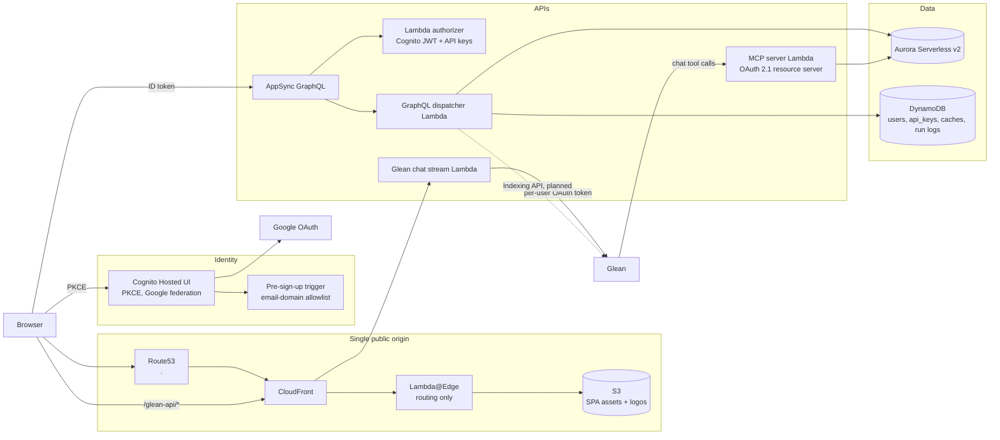

# External Hub Accelerator

A reference implementation for building a custom data portal (an "external
hub") on AWS that integrates with Glean in both directions:

- **Hub → Glean.** Your portal's data reaches Glean users where they already
  work. Glean chat calls the portal's MCP server at query time (federated
  access with read and write guardrails), and the portal can push records
  into Glean through the Indexing API.
- **Glean → Hub.** Glean's capabilities surface inside your portal: per-user
  Glean OAuth, chat streamed into the UI, and Glean-sourced people data.

The domain is yours. The accelerator ships the platform (identity, edge,
APIs, storage, environments, deploys, and the Glean integration points) plus
one small example domain so every path is exercised end to end. Replace the
example with an inventory, a vendor directory, a case tracker, or whatever
your portal is about.

This repository was extracted from PartnerSync, Glean's internal partner
account-planning portal, and sanitized: every environment-specific name,
account, hostname, and credential was replaced with a placeholder or an
environment variable.

## Status

| Layer | State | Notes |
|---|---|---|
| State backend bootstrap (`bootstrap/`) | Extracted | One S3 bucket per account, self-rehoming. |
| Terragrunt root + `example` env (`root.hcl`, `live/`) | Extracted | Account, region, domain, zone, and allowlist read from env vars. |
| Network, Aurora Serverless v2, Aurora schedule, DynamoDB, Secrets, Billing (`modules/infra/`) | Extracted | Validates with `terraform validate`; not yet applied in a clean account. |
| Cognito (Hosted UI + Google federation + email-domain gate) (`modules/infra/cognito`) | Extracted | Same. |
| GitHub OIDC deploy role (`modules/infra/github-oidc`) | Extracted | Trust pinned to GitHub Environments. |
| CloudFront + S3 multi-app SPA edge (`modules/app/s3-cloudfront-spa`) | Extracted | Edge handler tests pass. |
| Lambda authorizer, warmer, Glean chat stream, RUM (`modules/app/`) | Extracted | Module inputs point at `backend/dist/<app>`, which does not exist yet (see below). |
| Schema migration runner (`modules/data-pipeline/aurora-migrate`) | Extracted | Node-only. |
| AppSync GraphQL API + MCP server + observability dashboards (`modules/app/appsync`, `modules/app/mcp`, `modules/infra/observability`) | **Next** | Coupled to the source project's domain; being split into platform + example. |
| Backend (`backend/`: API, authorizer, MCP, stream, workers, shared libs) | **Next** | TypeScript Lambda monorepo. |
| SPA shell (`apps/portal/`) | **Next** | Vite + React, Cognito PKCE, Glean connect + chat. |
| Developer portal (`apps/dev/`) | **Next** | Docusaurus with generated GraphQL reference. |
| Deploy workflows (infra, backend, SPA) | **Next** | `workflow_dispatch`, GitHub OIDC, environment-gated. |
| Indexing API push of domain records | Planned | The Indexing API client exists in the source project for a narrow case and will be generalized. |
| Email / calendar sync into the portal | Planned | Builds on the per-user Glean OAuth token custody that ships with the stream Lambda. |

"Extracted" means the code is here, sanitized, and passes static validation
(`terraform validate`, Terragrunt input checks, the sanitization guard). It
has **not** yet been applied from scratch in an empty AWS account. Until that
run happens the deploy steps below are the intended procedure, not a verified
one.

## Layout

```
accelerator/
├── root.hcl                  # project name, GitHub coords, state backend, provider generation
├── .env.example              # every environment variable the stacks read
├── bootstrap/                # one-shot Terraform that creates the state bucket
├── live/
│   ├── _shared/github-oidc/  # one CI deploy role per AWS account
│   ├── _envcommon/spa.hcl    # SPA inputs shared by every env
│   └── example/              # one environment; copy the directory to add another
│       ├── env.hcl           # reads AWS_ACCOUNT, PORTAL_DOMAIN_ROOT, ... from the environment
│       ├── infra/            # network, aurora, aurora-schedule, dynamodb, cognito, secrets, billing
│       ├── app/              # spa, authorizer, glean-stream, warmer, rum
│       └── data-pipeline/    # aurora-migrate
├── modules/                  # reusable Terraform modules; no Terragrunt logic
│   ├── infra/
│   ├── app/
│   └── data-pipeline/
├── scripts/
│   ├── check-sanitized.sh    # fails on account ids, zone ids, tokens, source-project names
│   └── validate-modules.sh   # terraform validate for every module
└── .github/workflows/ci.yml  # runs the three checks above on every PR
```

Each `live/<env>/<group>/<stack>/terragrunt.hcl` wires one module with that
env's values and declares its dependencies, so `terragrunt run --all apply`
orders stacks correctly. State keys ignore the group folder, so moving a
stack between `infra/`, `app/`, and `data-pipeline/` never moves its state.

## Architecture



Design choices worth knowing before you adapt it:

- **One origin per environment.** CloudFront fronts the SPA and proxies the
  streaming API; AppSync and MCP get white-label hostnames in the same zone.
  The edge does routing only. Authorization happens where the data lives.
- **Opaque IDs.** Every native primary key is a prefixed random id
  (`usr_…`, `apk_…`). Upstream system ids are stored as attributes with
  indexes, never as keys, so swapping an upstream system never rewrites URLs.
- **Schema converges on apply.** `aurora-migrate` re-runs every migration on
  every apply; each is written `IF NOT EXISTS` / `ON CONFLICT`. No ledger.
- **Secrets are read at runtime, not apply time.** The CI role is denied
  `secretsmanager:GetSecretValue` except for the one Google OAuth client
  secret Cognito needs. Lambdas read everything else when they run.
- **Auto-pause by default.** Aurora Serverless v2 scales to zero in non-prod;
  the warmer runs once a day so pause still pays off. Production flips both.

## Prerequisites

- An **empty AWS account** (or one with no `<project>-tf-state-*` bucket), a
  credential with administrator access for the one-time bootstrap, and a
  Route 53 public hosted zone for the domain the portal will use.
- A **Google Cloud OAuth client** (web application) for Cognito federation.
- A **Glean tenant** with the OAuth authorization server enabled and Dynamic
  Client Registration allowed for the portal's callback URL.
- Terraform ≥ 1.6, Terragrunt ≥ 1.0, Node ≥ 20, Python 3 (edge tests only).

## First deploy

1. **Name the project.** Edit `root.hcl`: set `project` (prefixes every
   resource; choose once), `github_org`, and `github_repo`.
2. **Set the environment.** `cp .env.example .env.local`, fill in
   `AWS_ACCOUNT`, `PORTAL_DOMAIN_ROOT`, `ROUTE53_ZONE_ID`,
   `ALLOWED_EMAIL_DOMAINS`, `GLEAN_BASE_URL`, then `source .env.local`.
3. **Bootstrap state.**
   ```sh
   PROJECT=<project> ./bootstrap/bootstrap.sh $AWS_ACCOUNT $AWS_REGION
   ```
4. **Seed the Google OAuth secret.** Cognito reads it on first apply.
   ```sh
   aws secretsmanager create-secret --name <project>-example/oidc/google \
     --secret-string '{"web":{"client_id":"...","client_secret":"..."}}'
   ```
5. **Apply the environment.**
   ```sh
   cd live/example && terragrunt run --all apply
   ```
   Stacks apply in dependency order: network → aurora → dynamodb / cognito /
   secrets → aurora-migrate → authorizer / glean-stream → spa → warmer.
6. **Populate the remaining secret slots** declared in
   `live/example/infra/secrets` (`api-key-pepper`) with
   `aws secretsmanager put-secret-value`.
7. **Register the hosted-UI callback** with Google: add
   `https://auth.example.<domain_root>/oauth2/idpresponse` to the OAuth
   client's authorized redirect URIs.
8. **Wire CI.** `cd live/_shared/github-oidc && terragrunt apply`, then store
   the output `role_arn` as the repo secret `AWS_DEPLOY_ROLE_ARN` and create
   a GitHub Environment named `example` restricted to `main`.

The backend and SPA deploy steps land with the next increment.

## Adding an environment

Copy `live/example/` to `live/<env>/`, change `env` in `env.hcl`, add `<env>`
to `deploy_envs` in `live/_shared/github-oidc/terragrunt.hcl`, and create the
matching GitHub Environment. Everything else derives from the env name.

## Local checks

```sh
scripts/check-sanitized.sh          # no account ids, zone ids, tokens, or source-project names
terraform fmt -recursive -check
terragrunt hcl fmt --check
scripts/validate-modules.sh         # terraform validate per module
terragrunt hcl validate --inputs --working-dir live
python -m pytest -q modules/app/s3-cloudfront-spa/edge
```

CI runs the same set on every pull request.

## License

To be confirmed before publication.
