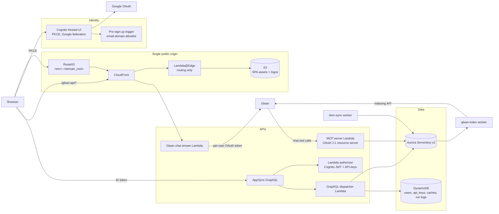

# External Hub Accelerator

A reference implementation for building a custom data portal (an "external
hub") on AWS that integrates with Glean in both directions:

- **Hub → Glean.** Your portal's data reaches Glean users where they already
  work. Glean chat calls the portal's MCP server at query time (federated
  access with read and write guardrails), and the portal can push records
  into Glean through the Indexing API.
- **Glean → Hub.** Glean's capabilities surface inside your portal: per-user
  Glean OAuth, chat streamed into the UI, and Glean-sourced people data.

The domain is yours. The accelerator ships the platform (identity, edge,
APIs, storage, environments, deploys, and the Glean integration points) plus
one small example domain so every path is exercised end to end. Replace the
example with an inventory, a vendor directory, a case tracker, or whatever
your portal is about.

This repository was extracted from PartnerSync, Glean's internal partner
account-planning portal, and sanitized: every environment-specific name,
account, hostname, and credential was replaced with a placeholder or an
environment variable.

## Status

| Layer | State | Notes |
|---|---|---|
| State backend bootstrap (`bootstrap/`) | Extracted | One S3 bucket per account, self-rehoming. |
| Terragrunt root + `example` env (`root.hcl`, `live/`) | Extracted | Account, region, domain, zone, and allowlist read from env vars. |
| Network, Aurora Serverless v2, Aurora schedule, DynamoDB, Secrets, Billing (`modules/infra/`) | Extracted | Validates with `terraform validate`; not yet applied in a clean account. |
| Cognito (Hosted UI + Google federation + email-domain gate) (`modules/infra/cognito`) | Extracted | Same. |
| GitHub OIDC deploy role (`modules/infra/github-oidc`) | Extracted | Trust pinned to GitHub Environments. |
| CloudFront + S3 multi-app SPA edge (`modules/app/s3-cloudfront-spa`) | Extracted | Edge handler tests pass. |
| Lambda authorizer, warmer, Glean chat stream, RUM (`modules/app/`) | Extracted | Bundle inputs match `backend/dist/<app>`. |
| Schema migration runner (`modules/data-pipeline/aurora-migrate`) | Extracted | Node-only. |
| AppSync GraphQL API, schema-driven resolvers, optional CSV exports (`modules/app/appsync`) | Extracted | Node-only. Domain workers replaced by a generic invoke hook. |
| MCP server, OAuth 2.1 resource server + DCR default-on (`modules/app/mcp`) | Extracted | Own hostname; the unified authorizer is optional for API keys. |
| Observability dashboards (`modules/infra/observability`) | Extracted | Function list and EMF namespace are inputs. |
| Backend (`backend/`: API, authorizer, MCP, stream, four workers, 21 shared libs) | Extracted | Platform scope: users, roster, access requests, login audit, API keys, Glean OAuth + chat, logos, notifications, warmer. `tsc`, `eslint`, 40 jest suites (pglite integration) green; 8 bundles build. MCP `tools/call` arguments are validated against each tool's `inputSchema` before the handler runs. |
| SPA shell (`apps/portal/`) | Extracted | Vite + React, Cognito PKCE, capability-gated shell, example-domain views, admin screens, Glean connect + "Ask Glean" chat. `tsc`, `eslint`, 17 vitest cases (route-render suite), production build green. |
| Example domain (`items`): schema, resolvers, sync worker, MCP tools, SPA views (`backend/libs/items`, `backend/apps/workers/item-sync`, `apps/portal/src/views/Item*`) | Extracted | Smallest domain exercising every path, including the MCP write guardrail: `createItem` lands as a `DRAFT` that a writer approves or rejects in the portal. Replace with yours. |
| Indexing API push of domain records (`backend/libs/glean-index`, `backend/apps/workers/glean-index`) | Extracted | Custom datasource, incremental on a schedule, full re-index from the admin screen; permissions derived from row visibility. Not yet run against a real tenant. |
| Generic scheduled worker (`modules/data-pipeline/scheduled-worker`) | Extracted | Lambda + EventBridge + Aurora IAM + named secret reads + invoke-on-apply; used by both example workers. |
| Developer portal (`apps/dev/`) | Extracted | Docusaurus at `/dev/` (in `spa_apps` and `spa_static_apps` for `example`, so deep links resolve at the edge); GraphQL reference generated from `backend/schema.graphql` (71 pages); Cognito-gated GraphiQL sandbox; MCP, Indexing, and auth docs. Builds clean. |
| Deploy workflows (`infra-deploy`, `spa-deploy`) | Extracted | `workflow_dispatch` only, OIDC via GitHub Environment claim, env inputs from Environment variables, live config from Terraform outputs. `actionlint` clean; not yet run against an account. |
| From-scratch apply in an empty account | **Open** | The only remaining step. Inputs listed under *What the first real deploy needs*. |
| Email / calendar sync into the portal | Planned | Builds on the per-user Glean OAuth token custody that ships with the stream Lambda. |

"Extracted" means the code is here, sanitized, and passes static validation
and tests (`terraform validate`, Terragrunt input checks, `actionlint`, the
sanitization guard, backend and SPA test suites, production builds). Nothing
has yet been applied from scratch in an empty AWS account; until that run
happens, *First deploy* below is the intended procedure, not a verified one.

## Layout

```
accelerator/
├── root.hcl                  # project name, GitHub coords, state backend, provider generation
├── .env.example              # every environment variable the stacks read
├── bootstrap/                # one-shot Terraform that creates the state bucket
├── live/
│   ├── _shared/github-oidc/  # one CI deploy role per AWS account
│   ├── _envcommon/spa.hcl    # SPA inputs shared by every env
│   └── example/              # one environment; copy the directory to add another
│       ├── env.hcl           # reads AWS_ACCOUNT, PORTAL_DOMAIN_ROOT, ... from the environment
│       ├── infra/            # network, aurora, aurora-schedule, dynamodb, cognito, secrets, billing, observability
│       ├── app/              # spa, authorizer, appsync, mcp, glean-stream, warmer, rum
│       └── data-pipeline/    # aurora-migrate, item-sync, glean-index
├── modules/                  # reusable Terraform modules; no Terragrunt logic
│   ├── infra/
│   ├── app/
│   └── data-pipeline/
├── backend/                  # Node Lambda monorepo: api, authorizer, mcp, stream, workers, libs, migrations, schema.graphql
├── apps/portal/              # Vite + React SPA: shell, example-domain views, admin screens, Glean connect + chat
├── scripts/
│   ├── check-sanitized.sh    # fails on account ids, zone ids, tokens, source-project names
│   └── validate-modules.sh   # terraform validate for every module
├── apps/dev/                 # Docusaurus developer portal: generated GraphQL reference, GraphiQL sandbox, MCP docs
└── .github/workflows/        # ci.yml on PRs; infra-deploy.yml and spa-deploy.yml on dispatch
```

Each `live/<env>/<group>/<stack>/terragrunt.hcl` wires one module with that
env's values and declares its dependencies, so `terragrunt run --all apply`
orders stacks correctly. State keys ignore the group folder, so moving a
stack between `infra/`, `app/`, and `data-pipeline/` never moves its state.

## Architecture



Design choices worth knowing before you adapt it:

- **One origin per environment.** CloudFront fronts the SPA and proxies the
  streaming API; AppSync and MCP get white-label hostnames in the same zone
  (`gql.<env>.<root>`, `mcp.<env>.<root>`). The edge does routing only.
  Authorization happens where the data lives.
- **MCP is an OAuth 2.1 resource server.** An MCP host discovers the server
  through RFC 8414 / 9728 metadata, registers a client with RFC 7591 DCR
  against Cognito, and presents access tokens scoped `<mcp-url>/read` or
  `/write`. Opaque API keys for service accounts ride the same unified
  authorizer the GraphQL API uses.
- **MCP writes are drafts.** A tool that creates a record (`createItem`)
  writes it with `status = 'DRAFT'` under the acting user and posts a
  notification to them. Drafts are hidden from default reads, from search,
  and from the Glean index until a writer approves (`ACTIVE`) or rejects
  (`REJECTED`, kept for audit) them in the portal. The host's confirmation
  panel and the server's `requireWrite` check gate in-place edits; neither
  needs a server-side draft state. A retried create is idempotent on acting
  user + name: it returns the pending draft instead of drafting twice.
- **Opaque IDs.** Every native primary key is a prefixed random id
  (`usr_…`, `apk_…`). Upstream system ids are stored as attributes with
  indexes, never as keys, so swapping an upstream system never rewrites URLs.
- **Schema converges on apply.** `aurora-migrate` re-runs every migration on
  every apply; each is written `IF NOT EXISTS` / `ON CONFLICT`. No ledger.
- **The schema is the wiring.** `backend/schema.graphql` defines the API and the
  appsync module creates one resolver per field from it; a spec pins the
  schema against the backend's field registry so the two cannot drift.
- **Roles are a small fixed set.** `ADMINISTRATOR`, `EDITOR`, `VIEWER`, plus an
  orthogonal admin flag, all in `app.access_roster`. An off-roster sign-in is
  recorded as an access request for an administrator to grant.
- **Secrets are read at runtime, not apply time.** The CI role is denied
  `secretsmanager:GetSecretValue` except for the one Google OAuth client
  secret Cognito needs. Lambdas read everything else when they run.
- **Auto-pause by default.** Aurora Serverless v2 scales to zero in non-prod;
  the warmer runs once a day so pause still pays off. Production flips both.

## What the first real deploy needs

Everything in this repository passes static validation and unit/integration
tests without an AWS account. The one step that still needs one is the
from-scratch apply, and it needs exactly these inputs. Gather them before
starting; nothing else is required.

### AWS

| Input | Where it goes | Notes |
|---|---|---|
| An **empty AWS account** (no `<project>-tf-state-*` bucket, no Cognito pools, no `<project>-*` resources) | `AWS_ACCOUNT` | A member account in your organization; do not reuse one that hosts other workloads. |
| A **region** | `AWS_REGION` | Default `us-east-2`. CloudFront and Cognito custom-domain certificates are created in `us-east-1` automatically. |
| An **administrator credential** for the one-time bootstrap | your shell | Creates the state bucket and the GitHub OIDC role. After that, CI deploys through the role; no long-lived keys. |
| A **budget alarm** | console | Not created by Terraform (the `billing` stack creates a per-env budget *after* the first apply). Set an account-level one first. |

### DNS

| Input | Where it goes | Notes |
|---|---|---|
| A **Route 53 public hosted zone** for the portal's domain | `PORTAL_DOMAIN_ROOT`, `ROUTE53_ZONE_ID` | The env is served at `<env>.<root>`; Cognito's hosted UI at `auth.<env>.<root>`; GraphQL at `gql.<env>.<root>`; MCP at `mcp.<env>.<root>`. A delegated subdomain of a domain you already own is enough: create the zone in the new account and add its four `NS` records to the parent zone. |

### Identity provider (sign-in)

| Input | Where it goes | Notes |
|---|---|---|
| A **Google Cloud OAuth client** (web application) | secret `<project>-<env>/oidc/google` as `{"web":{"client_id","client_secret"}}` | After the first apply, add `https://auth.<env>.<root>/oauth2/idpresponse` and `https://<project>-<env>.auth.<region>.amazoncognito.com/oauth2/idpresponse` to its authorized redirect URIs. |
| The **email domains** allowed to sign in | `ALLOWED_EMAIL_DOMAINS` | Comma-separated. Enforced by the Cognito pre-sign-up trigger and again by the token verifiers. |

### Glean tenant

| Input | Where it goes | Notes |
|---|---|---|
| The tenant's **backend origin**, `https://<tenant>-be.glean.com` | `GLEAN_BASE_URL` | Used by the per-user OAuth connection, chat streaming, and the Indexing push. |
| **OAuth authorization server enabled** with **Dynamic Client Registration** allowed for the portal's redirect URI `https://<env>.<root>/portal/glean/callback` (and `http://localhost:5173/glean/callback` for local work) | Glean admin console | Lets the portal register itself as a public PKCE client once per base URL (Glean → Hub). |
| The host Glean uses for **MCP OAuth callbacks** (your tenant backend host) | `MCP_REDIRECT_HOSTS` | Lets Glean register as an OAuth client of the MCP server (Hub → Glean, federated). |
| A **datasource-scoped Indexing API token** for `<project>_items` | secret `<project>-<env>/glean-indexing-token` | Created in the Glean admin console; needed only for the Indexing push (Hub → Glean, indexed). |

### Tools

Terraform ≥ 1.10 (S3-native state locking), Terragrunt ≥ 1.0, Node ≥ 20,
pnpm ≥ 10, Python 3 (helper tests only), AWS CLI.

## First deploy

1. **Name the project.** Edit `root.hcl`: set `project` (prefixes every
   resource; choose once), `github_org`, and `github_repo`.
2. **Set the environment.** `cp .env.example .env.local`, fill in the values
   from the table above, then `source .env.local`.
3. **Bootstrap state.**
   ```sh
   PROJECT=<project> ./bootstrap/bootstrap.sh $AWS_ACCOUNT $AWS_REGION
   ```
4. **Seed the Google OAuth secret.** Cognito reads it on first apply.
   ```sh
   aws secretsmanager create-secret --name <project>-example/oidc/google \
     --secret-string '{"web":{"client_id":"...","client_secret":"..."}}'
   ```
5. **Build the backend.** The Lambda stacks zip `backend/dist/<app>`.
   ```sh
   cd backend && npm ci && npm run build && cd ..
   ```
6. **Apply the environment.**
   ```sh
   cd live/example && terragrunt run --all apply
   ```
   Stacks apply in dependency order: network → aurora → dynamodb / cognito /
   secrets → aurora-migrate → authorizer / glean-stream / item-sync / glean-index
   → spa → appsync / mcp → warmer / observability. `item-sync` runs once on
   apply, so the Items screen has data from its fixture upstream immediately.
7. **Populate the remaining secret slots** declared in
   `live/example/infra/secrets` with `aws secretsmanager put-secret-value`:
   `api-key-pepper` (any long random string) and `glean-indexing-token`.
8. **Seed the first administrator** (the roster ships empty):
   ```sql
   INSERT INTO app.access_roster (email, role, is_admin) VALUES ('you@example.com', 'ADMINISTRATOR', true);
   ```
   Run it through the RDS Data API (`aws rds-data execute-statement`) or the
   query editor.
9. **Register the hosted-UI callbacks** with Google (see the table above).
10. **Wire CI.** `cd live/_shared/github-oidc && terragrunt apply`, then store
    the output `role_arn` as the repository secret `AWS_DEPLOY_ROLE_ARN`.
    Create a GitHub Environment named `example`, restrict its deployment
    branches to `main`, and set these **Environment variables** (the workflows
    read `env.hcl`'s inputs from them): `AWS_ACCOUNT`, `AWS_REGION`,
    `PORTAL_DOMAIN_ROOT`, `ROUTE53_ZONE_ID`, `ALLOWED_EMAIL_DOMAINS`,
    `GLEAN_BASE_URL`, `MCP_REDIRECT_HOSTS`, and optionally `PORTAL_NAME`,
    `UPSTREAM_URL`.
11. **Deploy the web apps.** Actions → **spa-deploy** → env `example`, app
    `portal`; then again with app `dev` for the developer portal. The workflow
    reads the GraphQL endpoint, Cognito, bucket, and distribution from
    Terraform outputs; it refuses to build if any is missing.
12. **Connect Glean.** Sign in at `https://example.<root>/portal/`, open
    Admin → Glean, connect your account, and press *Re-index now*. Then add
    `https://mcp.example.<root>/mcp` as an MCP server in the Glean admin
    console; Glean discovers the OAuth server and registers itself.

## Deploying changes

| Change | Run |
|---|---|
| Infrastructure or backend code (Lambda bundles) | Actions → **infra-deploy** → env, stack `all` or a stack path such as `app/appsync`. The workflow builds `backend/` first; `app/*` stacks apply `aurora-migrate` before themselves. |
| A migration | same as above (the `aurora-migrate` stack re-runs every migration; all are idempotent) |
| Web app or developer portal | Actions → **spa-deploy** → env, app |

Both workflows are `workflow_dispatch` only and assume the OIDC deploy role
from a job that declares the GitHub Environment, which is what the role's trust
policy is pinned to. Pull requests run `ci.yml` (infra validation, backend,
portal) and never touch AWS.

## Replacing the example domain

The example domain is one entity, `items`, chosen to touch every path. To
swap in yours:

1. **Schema**: add a migration under `backend/migrations/` (keep the opaque
   id, `external_id` satellite, `owner_user_id`, and `visibility_role`
   columns; they are what the platform's authz, sync, and indexing expect).
2. **Backend**: a service like `backend/libs/items`, a resolver like
   `backend/apps/api/src/items`, fields in `schema.graphql`, bindings in
   `registry.ts`. `schema-registry.spec.ts` fails until they agree.
3. **Sync**: copy `backend/apps/workers/item-sync` and replace `upstream.ts`
   with your system's client. Keep `externalId` stable.
4. **Index**: copy `backend/apps/workers/glean-index`; `toDocument` is the
   only function that knows your fields.
5. **MCP**: a read tool, an in-place write tool, and a create tool under
   `backend/apps/mcp/src/tools`, listed in `tools.ts`. Reuse the resolver
   classes so the MCP and GraphQL surfaces cannot disagree. Keep the create
   tool's `DRAFT` landing and the approve / reject mutations if assistant
   writes should stay reviewable; `items-review.integration.spec.ts` is the
   state-machine spec to copy.
6. **SPA**: views like `apps/portal/src/views/Item*`, routes in `App.tsx`,
   a nav entry in `Sidebar.tsx`, the route in `lib/routes.ts`.
7. **Infra**: one `scheduled-worker` stack per worker under
   `live/<env>/data-pipeline/`, the worker names in `infra/observability`.

Then delete the `items` files. Nothing else references them.

## Adding an environment

Copy `live/example/` to `live/<env>/`, change `env` in `env.hcl`, add `<env>`
to `deploy_envs` in `live/_shared/github-oidc/terragrunt.hcl`, and create the
matching GitHub Environment. Everything else derives from the env name.

## Local checks

```sh
scripts/check-sanitized.sh          # no account ids, zone ids, tokens, or source-project names
terraform fmt -recursive -check
terragrunt hcl fmt --check
scripts/validate-modules.sh         # terraform validate per module
terragrunt hcl validate --inputs --working-dir live
python -m pytest -q modules/app/s3-cloudfront-spa/edge modules/app/appsync
cd backend && npm ci && npm run lint && npm run typecheck && npm test && npm run build
cd apps/portal && pnpm install && pnpm exec tsc -b && pnpm exec eslint . && pnpm exec vitest run && pnpm build
cd apps/dev && pnpm install && pnpm typecheck && pnpm build
actionlint .github/workflows/*.yml
```

CI runs the same set on every pull request.

## Documents

- [White paper](docs/white-paper.md): the architecture, the four Glean
  surfaces, the guardrails, and how to adapt the platform to a new domain.
  Draft for internal review.
- [Extraction plan](docs/extraction-plan.md): the record of how this
  repository was extracted from PartnerSync, increment by increment.
- [Skill authoring](apps/dev/docs/mcp/skill-authoring.md): how to write the
  Glean skill (`SKILL.md`) and the MCP tool descriptions so Glean Chat routes
  to the right tool, with the routing failures the source project hit and a
  review checklist; the example skill for the shipped tools is at
  [`docs/mcp/skills/example/`](docs/mcp/skills/example/SKILL.md).

These documents refer to PartnerSync as "the source project"; this README is
the one place the sanitization guard lets the name appear.

## License

To be confirmed before publication.
