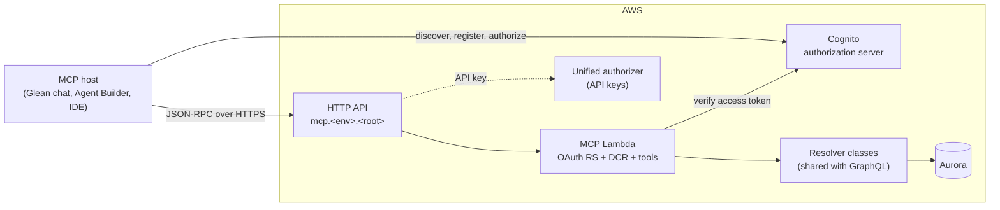
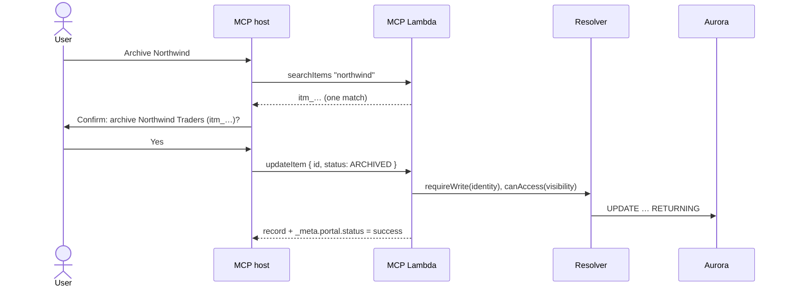
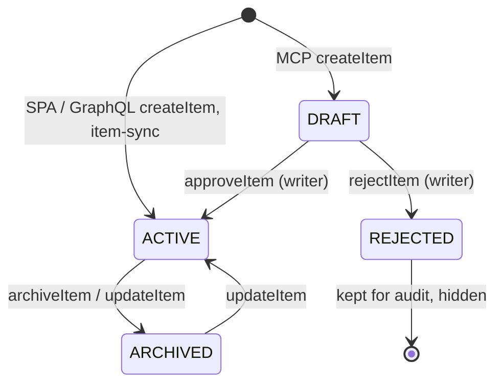

# MCP Design

How the server is built, and the guardrails that make an assistant's writes safe
to allow. These are the decisions a team adopting this accelerator inherits;
each one can be changed, but they fit together.

## Goals

- **Live, not copied.** The assistant reads the hub at query time. A number it
  quotes is the number the web app shows at that moment.
- **Same rules as the UI.** Every tool calls the resolver classes the GraphQL API
  uses. Visibility, write access, and validation are enforced once, in the
  resolvers, and the MCP server cannot bypass them.
- **A write is attributable and reviewable.** Every change names the person who
  asked for it, and the host confirms the change with that person before the
  call.
- **Honest results.** An empty answer, a partial answer, and a failure are
  distinguishable without reading prose.

## Where it sits

The Lambda is stateless and the transport is request/response, so there is no
long-lived session to manage; one request in, one response out.

## Tool catalog

The platform ships five tools. Two are the platform's own; three belong to the
example domain and show the pattern for yours.

| Tool | Kind | Purpose |
|---|---|---|
| `whoAmI` | read | The acting principal: user or key, email, roster role, write capability. Call first when a write reports a missing acting user. |
| `listUsers` | read | People the portal knows, optionally filtered. |
| `searchItems` | read | Example domain: live items by name/description/website with status and category filters. |
| `createItem` | write | Example domain: create an item as a `DRAFT` for a writer to approve in the portal. |
| `updateItem` | write | Example domain: change one item's fields or live status in place after the user confirms. |

Tool names are camelCase. Hosts may call `portal__searchitems` or `searchitems`;
the server resolves those to the canonical name.

Each tool declares MCP `annotations`. Hosts gate human-in-the-loop confirmation
on `readOnlyHint`; without it every tool gets an approval panel and the planner
learns to avoid the server. Read tools are `READ_ONLY`; write tools are
`UPDATES_IN_PLACE` (idempotent) or `CREATES_RECORDS`.

Every advertised description ends with a provenance note telling the host to use
the tool for record-level facts rather than an indexed copy, and read tools add
a rule to label any search additions as supplementary context. Both strings are
in `apps/mcp/src/mcp/tools.ts`.

## Writes and review gates

1. **Resolve, then confirm.** A write tool takes an id the host obtained from a
   read tool in the same conversation. Guessed ids are not allowed; the
   description says so, and an unknown id is a validation error.
2. **The user approves in chat.** The host shows the intended change and waits
   for explicit approval before `tools/call`. The annotation (`readOnlyHint:
   false`) is what makes the host ask.
3. **The server enforces independently.** `requireWrite` (admin, `EDITOR`, or a
   `write` scope) and the row's visibility are checked in the resolver, exactly
   as for the web app. The host's confirmation is a courtesy; the server's check
   is the control.
4. **The acting user is recorded.** With no acting user the write fails (see
   [Identity](#identity)). A shared fallback identity would silently misattribute
   every change, so there is none.

That is the whole gate for an in-place edit: the host's confirmation plus the
server's `requireWrite`. There is no server-side draft state for `updateItem`.

### Creates land as drafts

A create is different: the assistant is adding a record nobody has seen, so
the example domain routes it through a second, in-portal review.

- `createItem` (`CREATES_RECORDS`) writes the row with `status = 'DRAFT'`,
  owned by the acting user, and inserts an `app.notifications` row
  (`item_draft`) that links to it from the bell.
- A `DRAFT` is hidden from every default read: the items list, `searchItems`,
  and the Glean Indexing push all see live rows (`ACTIVE`, `ARCHIVED`) only.
  Writers open the review queue with `items(filter: { draftsOnly: true })`
  or the *Drafts awaiting review* option in the portal.
- `approveItem` publishes (`→ ACTIVE`); `rejectItem` declines (`→ REJECTED`,
  kept for audit, still hidden). Both require write access and update only
  `WHERE status = 'DRAFT'`, stamping `reviewedAt` / `reviewedBy`, so a repeated
  or crossed decision is a no-op that returns the row unchanged.
- `updateItem` can edit a draft's fields, but a status change applies to live
  rows only, so an in-place edit cannot publish around the review audit.
- The incremental indexer deletes a document whose row left the live set.

The state machine is pinned by
`backend/apps/api/src/items/items-review.integration.spec.ts`, which runs over
the real migrations. Copy that spec when you port the pattern to your domain.

## Identity

The connection authenticates the **client**. Writes need a **person**.

- **OAuth connections** carry the person in the access token. The server
  verifies the token, pins `aud` to the resource identifier, and resolves the
  email against the access roster. Scopes cap capability: a `read` grant cannot
  write even for an administrator.
- **Key connections** authenticate the integration, not a person. The acting
  user comes from `x-user-email` (if the host forwards one) or the tool's
  `currentUserEmail` argument.
- **No fallback.** `MCP_FALLBACK_USER_EMAIL` does not exist in this codebase on
  purpose.

`whoAmI` exists so a host can establish, once per conversation, who it is acting
as and whether that principal may write.

## Result contract

Every response carries `content[]` and `structuredContent`. Hosts often feed the
model only `content[].text`, so a read tool's text includes the rows that matter
(ids, names, the fields a follow-up write needs), not just a count.

`_meta.portal` is derived from the result, not declared by the tool:

| status | When |
|---|---|
| `success` | a result with at least one match, or a completed write |
| `no_matches` | a read that returned zero rows (`matches: 0`) |
| `partial` | a read that was truncated (`coverage.complete: false`) |
| `authorization_error` | the resolver threw `Unauthorized` |
| `validation_error` | the tool rejected the arguments (missing id, nothing to change); also set on the `-32602` the argument gate returns |
| `server_failure` | anything else |

### The argument gate

Before any handler runs, the server validates `arguments` against the tool's
advertised `inputSchema`: type, `required`, `additionalProperties: false`,
`enum`, `minimum` / `maximum`, `minLength` / `maxLength`. The only coercions
are the unambiguous host habits (a numeric string for an integer, `"true"` /
`"false"` for a boolean, a lone scalar for an array). Anything else is a
JSON-RPC `-32602` whose `data` carries the portal envelope plus a
`violations` list naming each path, and the handler is never called. Handlers
can therefore trust the shape they declared; the clamps some of them keep
(`searchItems` drops non-live statuses) are defense in depth, not the
control. `validate.spec.ts` pins both.

One exception is made before the check. Some hosts add arguments of their own
to every `tools/call`: Glean's write-action path sends `_user_goal`, the user's
prompt verbatim. The gate drops the names in `HOST_INJECTED_ARGUMENTS`
(`apps/mcp/src/mcp/validate.ts`) before validating, so tools keep
`additionalProperties: false` without declaring them and handlers never see
them. A tool that does declare one of those names receives it. Any other
undeclared argument is still a violation.

## Runtime constraints

- Lambda timeout 25s under a 29s API Gateway ceiling, so a slow call fails
  visibly rather than being cut off while the write still lands.
- Aurora Serverless v2 may be paused; the first call after idle can take tens of
  seconds while it resumes. The warmer keeps request-path Lambdas warm, not the
  database; a production environment sets a warm minimum ACU.
- `/register` is rate-limited at the stage so a scanner cannot fill the user
  pool's app-client quota.

## Adding a tool

Write `backend/apps/mcp/src/tools/<name>.ts` exporting a `ToolDefinition`:
JSON Schema input (with `additionalProperties: false`), annotations, and a
handler that calls a resolver class from `apps/mcp/src/container.ts`. List it in
`apps/mcp/src/mcp/tools.ts`. `routing.spec.ts` pins the provenance note on every
advertised description; `local-demo.spec.ts` runs the server end to end against
embedded Postgres. Re-sync the connection in your MCP host afterwards.
