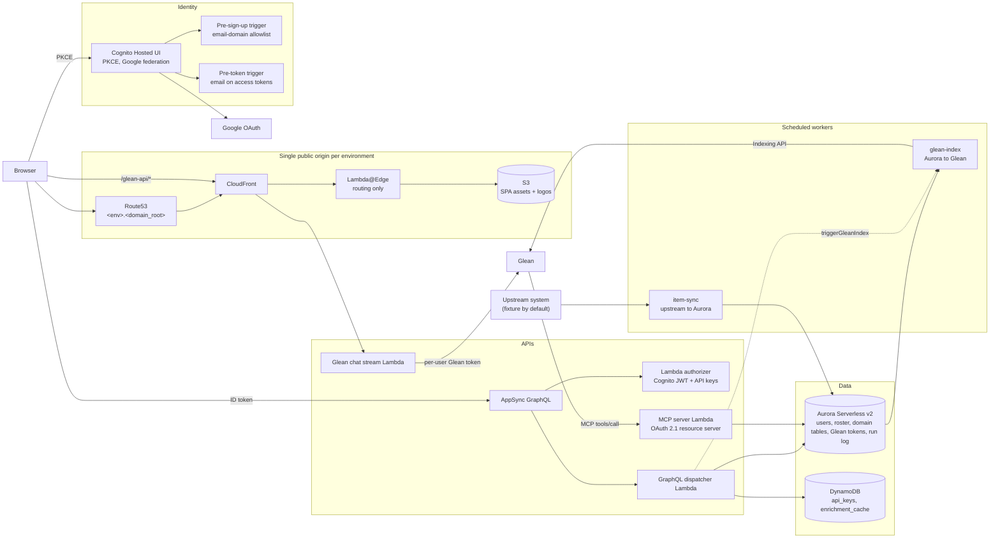

# External Hub Accelerator

## A reference architecture for Glean-integrated portals on AWS

*Source pin: source repository `main` @ `0193970`; branch `cursor/portal-accelerator-deploy-fb3e` @ `1c26b71` (PR #583, stacked on #582 @ `8e0dba5` and #580 @ `794b250`); `accelerator/` increments 1 to 5. The argument gate's host-injected-argument handling is in this repository at `b6bc77a` (PR #6), ahead of the source branch.*

**Status: Draft for internal review.** This paper describes the External Hub Accelerator, a sanitized, domain-neutral extraction of Glean's internal partner account-planning portal, called the source project below and named in the README. It is written for an internal reader first and for external customers and developers second. Nothing in it is final until the review closes.

### How to read the labels

Every capability in this paper carries one of three labels:

- **Implemented.** The code exists in the source project's `lambda-backend/` or in this repository, and the behaviour described was verified by reading that code and, where tests exist, running them. Where the source project runs it in only one environment, the paper says which. Where the code exists only in the accelerator and has not run against a live system, the paper says that too.
- **Extracted.** The code is in this repository, sanitized, and passes static validation and tests: `terraform validate`, Terragrunt input checks, `actionlint`, the sanitization guard, and the Python helper tests for infrastructure; `tsc`, `eslint`, `jest`, and `esbuild` for the backend; `tsc`, `eslint`, `vitest`, and a production build for the SPA; `tsc` and a Docusaurus build for the developer portal. Most of it was copied from the source project; some pieces were rewritten or written new for the accelerator, and the paper says which. Nothing has yet been applied from scratch in an empty AWS account.
- **Planned.** No code exists today. The paper describes an intended design and says so.

The consolidated table in section 12 uses two further markers: **Open** for a step that waits on an AWS account or a Glean tenant the project does not yet have, and **Gap** for a small code change identified in review and not yet approved. Neither changes what the code does today.

Where the planning document and the code disagree, this paper follows the code and notes the difference.

---

## 1. Summary

Organizations that build a custom data portal usually want it to meet Glean in both directions. Glean users want the portal's live records to answer their questions in chat. Portal users want Glean's answers inside the portal. Doing either well raises the same set of problems: a retrieval-first assistant that answers from a stale indexed export instead of the live system, AI-initiated writes that go live without a human looking at them, per-user tokens for a second identity provider, and an environment layout that drifts between dev and production.

The source project solved those problems for one domain (partners, accounts, opportunities). The External Hub Accelerator keeps the platform that solved them and drops the domain. It ships as a Terraform/Terragrunt tree (18 modules, 19 stacks), a TypeScript Lambda backend (eight Lambda apps, 21 shared libraries, five migrations, a 34-field GraphQL schema), a React single-page shell, a Docusaurus developer portal with a generated GraphQL reference, two `workflow_dispatch` deploy workflows, and one small example domain, `items`, so every path can be exercised end to end. All of that is extracted and passes its tests. Two things remain open, and both need accounts the project does not yet have: the from-scratch apply in an empty AWS account, and the first Indexing API push against a real Glean tenant.

The Glean integration has four surfaces. Three are implemented in the source project and carried over; the fourth, the Indexing API push, was built in the accelerator. Hub to Glean therefore has both the federated path (MCP at query time) and the indexed path (documents pushed ahead of time) in code. One row remains planned:

| Direction | Surface | State |
|---|---|---|
| Hub to Glean | MCP server with read and write guardrails, OAuth 2.1 resource server with Dynamic Client Registration | Implemented (OAuth enabled in one source-project environment); extracted with OAuth required, two platform tools, three example-domain tools including a create tool whose records land as reviewable drafts, and one improvement the source project does not have: arguments are validated against each tool's schema before any handler runs |
| Hub to Glean | Indexing API push of portal records | Implemented in the accelerator: a generic client plus a worker that pushes the example domain with permissions derived from row visibility, incremental on a schedule and full re-index from the admin screen. Not yet exercised against a real Glean tenant. The source project itself has only a narrow sandbox-enrollment case |
| Glean to Hub | Per-user Glean OAuth with server-side token custody | Implemented; extracted |
| Glean to Hub | Glean chat streamed into the portal UI | Implemented; extracted, with an "Ask Glean" panel on the portal home |
| Glean to Hub | Email and calendar sync into the portal | **Planned**; no code |

The rest of this paper explains the architecture, walks through each surface, states the guardrails precisely, and ends with how to adapt the accelerator to a new domain and what the source project runs in production.

---

## 2. The problem

A portal that holds operational records (who owns which account, which vendor covers which site, which case is open) becomes more useful when the organization's assistant can reach it. Three failure modes show up as soon as a team tries.

**The assistant answers from the wrong source.** Glean Assistant is retrieval-first. If the portal's data has ever been exported to a spreadsheet or indexed as a document, the assistant will prefer that indexed copy over a tool call unless the tool asserts precedence. The result is a confident answer built on last quarter's export. The source project addresses this in the tool descriptions themselves and in a provenance envelope on every response (section 5.1).

**AI writes go live.** When a model can create records through its host, a mis-resolved name or a hallucinated field lands in reports. The source project's rule is that an AI-initiated write never goes live directly. Activities land as `DRAFT`; mapping uploads land as `PENDING_REVIEW`; outreach is drafted but never sent (section 5.3).

**Two identity providers, one user.** The portal authenticates with its own identity provider (Cognito federating Google). Glean is a second OAuth authorization server. A per-user Glean token must be minted, stored, refreshed, and never shown to the browser. The MCP server has the mirror-image problem: Glean must obtain a token that identifies the acting user to the portal, with scopes that cap what the client may do (sections 5.4 and 6.1).

Underneath those three sits the infrastructure problem every multi-environment project has: keeping `dev`, `uat`, and production identical in shape while differing in account, hostname, and capacity, and letting CI deploy to each without a long-lived credential (section 8).

---

## 3. What the accelerator is, and is not

### 3.1 Core versus example domain

The accelerator separates two things the source project keeps in one repository.

**Core (the platform).** Identity, edge, APIs, storage, environments, deploys, and the Glean integration points. Most of this code keeps its logic and loses its names: every resource is `${project}-<thing>-<env>`, every identifying value is an environment variable. A few pieces carried the source project's sales organization in their shape and were rewritten rather than copied: the roster (roles are now `ADMINISTRATOR`, `EDITOR`, `VIEWER`, with no seed rows and no title-based derivation), authorization (`requireWrite` replaces `requirePartnerSide`; a generic `visibilitySql`), the identity service (a registry of `usr_` ids keyed by email, with no Salesforce id mapping), the users and roster resolvers, the MCP tool set, and the MCP `/logos` route.

**Example domain.** One entity, `items`, in its own `example` schema: a migration, a service with visibility-scoped reads, GraphQL resolvers (10 of the 34 schema fields: `items`, `item`, `itemCategories`, `gleanIndexRuns`, `createItem`, `updateItem`, `archiveItem`, `approveItem`, `rejectItem`, `triggerGleanIndex`), an `item-sync` worker that upserts by `external_id` from a fixture upstream (`UPSTREAM_URL` swaps in a real one) and resolves owners into the user registry, three MCP tools (`searchItems`, `updateItem`, `createItem`), a `glean-index` worker that pushes items to a custom Glean datasource, and list, detail, edit, and review views in the SPA. The row shape is the contract: an opaque `itm_` id, an `external_id` satellite, `owner_user_id`, `visibility_role`, a `status` that is either live (`ACTIVE`, `ARCHIVED`) or under review (`DRAFT`, `REJECTED`), `synced_at`, `indexed_at`, and a review audit (`reviewed_at`, `reviewed_by_*`). Everything else in the platform (authorization, sync, indexing, review) keys off those columns. The source project's full partner/account/opportunity/private-equity model, its Salesforce sync workers, mapping uploads, CSV exports, data-quality flags, and Slack digest are not carried.

**Dropped.** The V1 Supabase backfill, the partner sandbox stacks (`live/partners`, `modules/partner-sandbox`), admin scripts, integration probes, the CDK static-site mockup, and the planning documents. From the backend: Salesforce sync, uploads and mapping, the exports and validation workers, private equity, Slack, sandbox access, title-to-role derivation, the directory, and every partner-domain resolver and tool.

### 3.2 Status at the pinned commit

Increments 1 to 5 of the extraction are in this repository. The table mirrors the README; counts were re-checked against the tree and the test runs and builds repeated at the pinned commit.

| Layer | State |
|---|---|
| State backend bootstrap, Terragrunt root, `example` environment | Extracted |
| Network, Aurora Serverless v2, Aurora schedule, DynamoDB, Secrets, Billing | Extracted |
| Cognito (Hosted UI, Google federation, email-domain gate, MCP resource server) | Extracted |
| GitHub OIDC deploy role | Extracted |
| CloudFront + S3 multi-app SPA edge | Extracted; 16 edge handler tests pass |
| Lambda authorizer, warmer, Glean chat stream, RUM | Extracted; bundle inputs match `backend/dist/<app>` |
| Schema migration runner | Extracted |
| AppSync GraphQL API with schema-driven resolvers | Extracted; Node-only; domain worker grants replaced by a generic invoke hook |
| MCP server stack, OAuth 2.1 + DCR required | Extracted; own hostname; the unified authorizer is optional (API keys) |
| Observability dashboards | Extracted; function list and metrics namespace are inputs |
| Generic `scheduled-worker` module (Lambda + EventBridge + Aurora IAM + named secret reads + invoke-on-apply) | Extracted; replaces the source project's per-entity sync modules; used by both example workers |
| Backend: `api`, `authorizer`, `mcp`, `stream`, `workers/{migrate,warmer,item-sync,glean-index}`; 21 shared libraries; five migrations; 34-field `schema.graphql` | Extracted; `tsc`, `eslint`, 40 jest suites (304 tests, 3 skipped) green at `b6bc77a`; eight bundles build |
| MCP argument gate (`apps/mcp/src/mcp/validate.ts`) | Written for the accelerator; the source project has no equivalent. A 14-case spec proves an out-of-schema call never reaches a handler, that host-injected arguments are dropped before the check and only those, and that every registered tool advertises a closed object schema |
| Example domain `items`: schema, service, resolvers, sync worker, three MCP tools, SPA views including the draft review queue | Extracted (written for the accelerator); the review state machine and the idempotent create are pinned by a 14-case integration spec over the real migrations |
| Indexing API push: `libs/glean-index` client and `workers/glean-index` | Extracted (written for the accelerator); an integration spec runs sync, read/write, visibility, and the push against a fake Glean; not yet run against a real tenant |
| SPA shell `apps/portal` | Extracted; rewritten over the copied UI kit, styles, OIDC user manager, telemetry, and GraphQL client; `tsc`, `eslint`, 17 vitest cases in 3 files, production build green at the pinned commit; no demo or seed mode |
| Developer portal `apps/dev` | Extracted; Docusaurus at `/dev/`, Cognito-gated GraphiQL sandbox, GraphQL reference generated from `backend/schema.graphql` (71 pages at the pinned commit), MCP and Indexing docs rewritten for the platform; builds clean |
| Deploy workflows `infra-deploy`, `spa-deploy` | Extracted; `workflow_dispatch` only, OIDC through the GitHub Environment claim; `actionlint` clean; not yet run against an account |
| From-scratch apply in an empty account | **Open**; the README's "What the first real deploy needs" lists every input |
| First Indexing push against a real Glean tenant | **Open** |
| Email and calendar sync | Planned |

Validation so far is static plus unit and in-process integration tests (four suites run the real migrations on embedded Postgres). The first apply in an empty AWS account waits on a verification account.

---

## 4. Architecture

### 4.1 Request path

A browser loads the SPA from CloudFront. Lambda@Edge does routing only: vanity host to canonical host (301), root to the default app, trailing slash to `index.html`, per-app SPA fallback, and real-object pass-through for multi-page static apps. The developer portal is one such app: a Docusaurus site built with `baseUrl: /dev/` and trailing slashes, uploaded beside the SPA under `/dev/`, with a client-side Cognito gate over the whole site and a GraphiQL sandbox that calls the environment's GraphQL endpoint with the signed-in user's token. The example environment lists it in `spa_apps` and `spa_static_apps`, and the Cognito stack derives a callback URL for every app in `spa_apps`, so the sandbox sign-in returns to `/dev/`. The edge performs no authentication. The SPA holds its OIDC tokens in `localStorage`, not in a cookie the edge could read, and the edge handler's own docstring explains why: a verifier key at the edge is the stealable-key risk the design removed. Authorization happens where the data lives. *(Implemented; extracted to `modules/app/s3-cloudfront-spa/edge/edge.py`.)*

The SPA signs in through Cognito Hosted UI with Authorization Code + PKCE (`oidc-client-ts`, public client, no secret). Cognito federates to Google. A pre-sign-up trigger rejects any federated identity whose email domain is not in the allowlist and auto-confirms the rest. The pool is federated-only: `allow_admin_create_user_only = true`, no password flows on the app client. *(Implemented; extracted.)*

Data calls go from the SPA straight to AppSync with the Cognito ID token as the bearer. AppSync's primary authentication mode is `AWS_LAMBDA`: a shared authorizer Lambda resolves the bearer to a principal and returns it in the resolver context; `AWS_IAM` stays as a secondary provider for SigV4 callers such as CI. Resolvers are schema-driven: a parser classifies every `Query` and `Mutation` field in `schema.graphql`, Terraform creates one pipeline resolver per field, and a single dispatcher Lambda resolves `Type.field` to a handler. Adding a field is a schema edit plus a resolver method; middleware composes as additional pipeline functions. *(Implemented in the source project; extracted to `modules/app/appsync` and `backend/apps/api`.)*

Glean chat goes same-origin through CloudFront at `/glean-api/*` to a response-streaming Lambda behind a regional REST API with a Cognito User Pools authorizer. The MCP server is a separate Lambda behind an HTTP API, published on its own hostname. Both are described in sections 5 and 6.

Off the request path, scheduled workers move data in and out. Every one of them is an instance of one Terraform module, `scheduled-worker`: a Node Lambda with Aurora Data API access, an EventBridge schedule, optional read access to named secrets, and an optional invoke on apply so a fresh environment has data before its first scheduled run. The worker's behaviour comes from its bundle and environment variables, not from Terraform. The example environment runs two: `item-sync` (hourly, invoked on apply) pulls the example domain from its upstream, and `glean-index` (every 15 minutes) pushes it to Glean. The source project has one module per sync entity; the accelerator has one module and one stack per worker. *(Extracted: `modules/data-pipeline/scheduled-worker`, `live/example/data-pipeline/{item-sync,glean-index}`.)*

### 4.2 Design choices worth knowing before you adapt it

**One origin per environment.** CloudFront fronts the SPA and proxies the streaming API. AppSync and MCP get white-label hostnames in the same zone (`gql.<env>.<domain_root>`, `mcp.<env>.<domain_root>`). Cookie scope, Cognito callback URLs, RUM's domain check, and `localStorage` all key off one host.

**Opaque IDs.** Every native primary key is a prefixed random id (`usr_…`, `apk_…`, `prt_…`). Upstream system ids (Salesforce, Google) are stored as attributes with indexes, never as keys, so swapping an upstream system never rewrites a URL.

**Schema converges on apply.** The `aurora-migrate` stack invokes a Lambda during `terragrunt apply` whenever the migration package hash changes. The Lambda runs every migration file in order over the RDS Data API. Each migration is written `IF NOT EXISTS` / `ON CONFLICT`, so there is no applied-migrations ledger and a re-run is a no-op. The source project has 82 migration files under this model; the accelerator consolidates its platform tables into four and adds a fifth (`100_example_items.sql`) for the example domain, numbered apart so an adopter's domain migrations slot in after the platform's. *(Implemented; extracted.)*

**Secrets are read at runtime.** The CI deploy role is denied `secretsmanager:GetSecretValue` except for an explicit allowlist, which in the example environment is the one Google OAuth client secret Cognito needs at apply time. Lambdas read everything else when they run. CI may create and tag secret slots; it cannot read or write their values. *(Implemented; extracted.)*

**Auto-pause by default.** The Aurora module defaults to `min_capacity = 0` with a 3600-second pause timer, `max_capacity = 1.0`, Data API enabled, and IAM database authentication on. The example warmer runs `rate(1 day)` so pausing still pays off; the module's own default schedule is every five minutes on weekdays, which is what a production environment would use. A separate `aurora-schedule` stack can raise the minimum ACU during business hours and lower it after, using EventBridge Scheduler's timezone-aware schedules calling `rds:ModifyDBCluster` directly. *(Extracted.)*

---

## 5. Hub to Glean

A production MCP server plays three roles at once. It is a **tool contract** the model reads: names, descriptions, and input schemas are the runtime interface, not documentation. It is a **protected resource** the enterprise trusts: it establishes who is calling, validates the credential, and enforces access before it returns data or acts. And it is a **network service** the edge lets through: discovery, registration, sign-in, and tool calls all cross load balancers, proxies, firewalls, and rate limits that can fail them before the tool function ever runs. Glean's internal MCP series states the three roles this way (Thomas Ledger, *What an MCP Server Actually Is: Five Design Choices for Production*, Part 5), and this section is organised to match: 5.1 to 5.3 are the contract, 5.4 the protected resource, 5.5 the network service, 5.6 the governance around all three. The Indexing API push (5.7) is the other Hub to Glean path and is not an MCP concern.

**Why a custom server rather than Glean's managed one.** Glean's managed remote MCP server exposes Glean-indexed content under Glean's access model, and nothing here replaces it. The hub is a proprietary system with its own records and its own write actions (draft an item, edit a mapping), which is the case the series itself names for building a custom server. The two paths meet in the middle: the Indexing API push (5.7) sends hub records to the managed side so they appear in search, and the MCP server serves live records and writes at query time. Govern distribution of the custom server centrally (5.6) rather than letting each team configure point-to-point connections.

### 5.1 The MCP server

**Protocol.** The MCP server is a Node Lambda that hand-rolls JSON-RPC 2.0 over the stateless Streamable HTTP transport: one request in, one response out, notifications get `202` and no body. It implements `initialize`, `notifications/initialized`, `ping`, `tools/list`, and `tools/call`. The code comment explains the choice: the MCP SDK's server transport assumes a long-lived process, which a Lambda is not. The protocol version is pinned: `initialize` returns `2025-06-18` regardless of the version the client proposes, and no later request reads an `MCP-Protocol-Version` header. The series reports that the July 2026 specification makes the protocol stateless, so that no request need return to the same server instance; the Lambda design satisfies that by construction, since there is no instance to return to and no session kept between calls. Version negotiation is listed as a gap in section 13. Dynamic discovery is not something this server drives: `capabilities.tools.listChanged` is `false`, and selecting among advertised tools is the host's job. The one accommodation is name resolution (below). *(Implemented: `lambda-backend/apps/mcp/src/mcp/server.ts`; extracted to `backend/apps/mcp`.)*

**Tools: reference and platform.** the source project's registry holds 16 tools. (The planning document says 15; the code and the developer-portal tools page both say 16.) Eleven are annotated read-only: account/partner context, partner search and detail, activities, opportunities, private-equity portfolio opportunities, mapped partners for accounts, mapped accounts for a partner, a mapping batch, a partner brief, and partner outreach guidance. Five write: `createActivity`, `createActivities`, and `createMappingBatch` create records; `updateActivity` and `updateAccountMapping` edit in place. Those 16 are the reference for what a domain layer adds.

The accelerator's own tool catalog is five tools. Two are platform, both read-only: `whoAmI`, which reports the acting principal as the server sees it (signed-in user or service key, email, roster role, admin flag, whether the connection may write), and `listUsers`, which lists portal users filtered by a name or email fragment. `whoAmI` exists so a host can tell a missing identity from a missing permission before it tries a write. Three belong to the example domain: `searchItems` (read-only; visibility-scoped through the same resolver the GraphQL API uses), `updateItem` (edits one live item in place), and `createItem` (creates a record that lands as a draft for review). Section 5.3 describes the three server-side controls on writes. An adopter deletes the three example tools and writes their own against their resolvers. The server name, scope statement, and provenance `source` derive from `PORTAL_NAME`; the envelope key is `_meta.portal`. *(Extracted: `backend/apps/mcp/src/tools/{whoAmI,listUsers,searchItems,createItem,updateItem}.ts`, `mcp/tools.ts`.)*

The test the series applies to a catalog is whether a model could choose the right tool from its name and description alone. Each description here says what the tool returns, what to call next (`searchItems`: "Use the returned id with updateItem"), and what to confirm first (`createItem`: "Confirm name and category with the user before calling"), and the names describe outcomes rather than tables. The catalog is served whole to every caller: `tools/list` takes no identity, so a read-only connection sees the write tools it cannot use. At five tools that is not noisy; at the source project's sixteen it starts to be, and a per-capability filter on `tools/list` is listed as an improvement in section 13.

**Tool annotations.** Every tool declares the MCP `ToolAnnotations` from the 2025-03-26 spec: `readOnlyHint`, `destructiveHint`, `idempotentHint`, `openWorldHint`. The reason is practical. Hosts gate human-in-the-loop confirmation on `readOnlyHint`; without it every tool, reads included, gets an approval panel and the planner learns to avoid the server. Three presets exist: `READ_ONLY`, `CREATES_RECORDS`, and `UPDATES_IN_PLACE`. Annotations are hints for the host, not an authorization boundary: the specification tells clients to treat annotations from untrusted servers as hints, and nothing on the server reads them to decide anything. Permissions and approval are enforced in the resolver gates of section 5.3, where policy applies whatever a tool says about itself. *(Implemented: `annotations.ts`.)*

**Precedence in descriptions.** Every advertised description gets a fixed suffix stating that the tool is the source for its record-level task however the prompt is phrased, and that the model must never substitute Salesforce, Glean Search, spreadsheets, indexed documents, prior chats, or memory for a fact the tool owns. Read tools add a second line: label any Glean-search additions "Supplementary context"; tool figures win on conflict. The server's `initialize` response carries a scope statement as `instructions`, positive scope first and exclusions second, which the host weighs when deciding whether this server owns a prompt at all. *(Implemented: `tools.ts`, `server.ts`.)*

**Provenance envelope.** Every `tools/call` response carries a `_meta` envelope keyed by the project name (`_meta.portal` in the accelerator) with `source`, `retrievedAt`, a derived `status` (`success`, `no_matches`, `partial`, `authorization_error`, `validation_error`, `server_failure`), optional `matches`, `unmatched`, `coverage {complete, returned, total}`, `dataAsOf`, and a one-line `summary`. The status is derived from the result rather than guessed, so an empty result and a failure never read alike and the model cannot narrate one as the other. Exceptions return the same envelope on the JSON-RPC error. *(Implemented: `server.ts`.)*

**Name resolution.** Glean Tool Search stores tool names as `<server>__<lowercased name>` and may call either spelling. The registry resolves exact, prefixed, and lower-cased names, while `tools/list` keeps advertising canonical camelCase. This is the only accommodation the server makes for host-side discovery. *(Implemented.)*

### 5.2 Read guardrails

**Scoping to the acting user.** Tools that accept `mine: true` resolve the caller's email to the upstream user id the data is keyed on. If no email is available, the tool returns an instructive error asking the assistant to collect the user's work email and retry, rather than returning the whole organization. An unknown email returns a "could not find" error, not an empty set. *(Implemented: `tools/aeScope.ts`.)*

**Row-level visibility.** Partner rows carry an optional `visibility_role`. The authorization service renders a SQL predicate from the caller's roster role and admin flag (`TRUE` for admins; `visibility_role IS NULL OR = '<role>'` otherwise). Roles are validated against a fixed set before inlining. The same check gates single-row writes. *(Implemented: `libs/authz`; extracted as the generic `visibilitySql(visibility, column)` and `canAccess` in `backend/libs/authz`.)*

**Candidates over guesses.** Ambiguous names return candidates for the assistant to confirm with the user. Where the write path must pick (a common partner name matching several records), it ranks by name closeness then by importance and relies on the draft-plus-approval gate to catch a wrong pick. *(Implemented: `activityWrite.helpers.ts`, `rank.ts`.)*

**Closed input schemas.** Every input schema sets `additionalProperties: false`. Enumerated fields (activity types, meeting formats, outreach stages) are hard enums so a model cannot invent a value and have it stored verbatim. Glean injects `_user_goal` into write-action calls; schemas declare it so the host's validator accepts the payload, and the server ignores it. In the source project the schema is advertised to the host and trusted; the server passes arguments to handlers unchecked, so each handler re-validates what it cares about. *(Implemented: `mcp/glean.ts`, tool schemas.)*

**Schema enforcement at the protocol boundary.** The accelerator adds what the source project lacks: one validation step in `tools/call` dispatch, before any handler, that checks the arguments against the tool's advertised `inputSchema`. It enforces `type`, `required`, `additionalProperties: false`, `enum`, `minimum`/`maximum`, and `minLength`/`maxLength`, recursing into `properties` and array `items`. It coerces only what hosts send with unambiguous intent (a numeric string for a number, `"true"`/`"false"` for a boolean, a lone scalar for an array) and treats anything else as a violation. A failing call returns JSON-RPC `-32602` carrying the portal envelope with `status: validation_error` and a `violations` list naming each path (`limit: must be <= 100`, `bogus: not an accepted argument`); the handler never runs. `ToolDefinition.inputSchema` is typed as the supported `JsonSchema` subset, so a tool cannot advertise a construct the gate does not enforce. One class of key is handled before the schema check: hosts inject arguments of their own, and Glean's write-action path adds `_user_goal` (the user's prompt, verbatim) to every call it makes. The source project's answer was to declare `_user_goal` in every write tool's schema and ignore it (above); the accelerator's gate instead strips the names in `HOST_INJECTED_ARGUMENTS` (today: `_user_goal`) before the closed-schema check unless the tool's own schema declares them, so tools keep `additionalProperties: false`, handlers never see the field, and any other undeclared key is still a violation. A spec proves the three properties that matter: an out-of-schema call never reaches a handler, host-injected arguments are dropped before the check and only those, and every registered tool advertises a closed object schema so the gate has something to enforce. *(Written for the accelerator: `backend/apps/mcp/src/mcp/{validate,server}.ts`, `validate.spec.ts`; the host-injected handling is in the External-Hub-Accelerator repository at `b6bc77a`.)*

### 5.3 Write guardrails

The write rules are the part of this design most worth copying. The source project established them; the accelerator carries them as three server-side controls that every assistant write passes through in order: schema validation at the protocol boundary (section 5.2), `requireWrite` plus row visibility in the resolver, and, for creates, the `DRAFT` review state with idempotent creates. The host's confirmation panel sits in front of all three and is a courtesy, not a control: the series' checklist asks "which tools can change or delete data, and where is approval enforced?", and the answer here is "in the server, on every path". This subsection first states the source project's rules from its code, then the accelerator's controls from its code.

#### The source project's rules

**An AI write never goes live directly.** `createActivity` and `createActivities` set `status: 'DRAFT'`. A draft does not appear in reports. A human approves or rejects it in the portal's notification center through `approveActivity`, `approveActivities`, or `rejectActivity`, which are admin or partner-manager only and no-op unless the row is still `DRAFT`. `createMappingBatch` stages rows as a `PENDING_REVIEW` upload batch; matched rows become live only when a partner-team reviewer publishes the batch in the portal. *(Implemented: `createActivity.ts`, `createMappingBatch.ts`, `partner-write.resolver.ts`.)*

**Owner comes from the authenticated identity.** The acting user's email is read from the resolved principal first and from the `currentUserEmail` argument only when no authenticated identity exists. The precedence was flipped deliberately after an attribution incident (section 11): a model-supplied identity field must never override an authenticated one. *(Implemented; documented in `docs/mcp/attribution-decision.md`.)*

**Role gate plus scope cap.** Writes call `requirePartnerSide`, which passes for admins and partner-side roster roles, or for an API key carrying the `write` or `admin` scope. An OAuth user token with explicit scopes is additionally capped: a `read`-only grant cannot write whatever the person's roster role says. In the accelerator the gate is `requireWrite`: admins, the `EDITOR` role, or a key with `write` or `admin` scope; the scope cap is unchanged. *(Implemented: `libs/authz`; extracted and renamed.)*

**Content-based idempotency.** Before drafting, the tool looks for an existing draft with the same partner, title, start time, and owner, and returns it with `idempotent: true` instead of writing again. A retried call, or a retried row inside a bulk batch, cannot double-draft. *(Implemented.)*

**Shaped, not stored verbatim.** Partner-side attendees are always written with `company: 'PARTNER'` and a mapped role; job titles echoed from a calendar invite never reach the enum column. `endAt` is derived from `startAt` plus duration; format defaults to `VIRTUAL`. *(Implemented.)*

**In-place edits stay narrow.** `updateAccountMapping` edits one live mapping's counterpart contact and relationship label. Match state (relinking, verifying) is not editable from chat and stays in the portal. *(Implemented.)*

#### The accelerator's three controls

**Control one: the argument gate.** Before a write tool's handler runs, its arguments have passed the schema check described in section 5.2. For `updateItem` that means the `id` is present, `status` is one of the live values, and no undeclared key is accepted; for `createItem`, that `name` is present. A host that ignores the advertised enum gets `-32602` and a `violations` list, not a write. The one exception is deliberate: the `_user_goal` key Glean's write-action path injects on every call is dropped at the gate before the check, so a write from Glean Chat reaches `createItem` or `updateItem` with a clean argument set instead of failing on a key no tool declares. The handlers still clamp what matters to them (`searchItems` filters `status` to live values again) as defense in depth, not as the control.

**Control two: the resolver gate.** Every MCP write calls the same resolver class the GraphQL API uses, so the checks run once and the MCP server cannot bypass them. The resolver requires `requireWrite` (admin, `EDITOR`, or a `write` scope) and the row's visibility, and an acting user: a connection with no signed-in user must supply `currentUserEmail` or the write fails rather than being attributed to nobody. For an in-place edit this is the whole server-side gate. `updateItem` (annotated `UPDATES_IN_PLACE`) changes one live row by id from a fixed field list (`name`, `category`, `description`, `website`, `status` within the live values); the host asks the user to confirm because the tool is not annotated read-only, and the resolver comment says which side is the control (the server's). There is no draft state for an edit. *(Extracted: `backend/apps/mcp/src/tools/updateItem.ts`, `apps/api/src/items/items.resolver.ts`.)*

**Control three: creates land as drafts, once.** A create is different: the assistant is adding a record nobody has seen. `createItem` (annotated `CREATES_RECORDS`, same acting-user rule) calls a separate resolver path, `draftItem`, which writes the row with `status = 'DRAFT'` owned by the acting user and inserts an `app.notifications` row of kind `item_draft` that links to it from the portal's bell. The same user creating from the SPA or GraphQL writes `ACTIVE` directly; the draft path is for the assistant. From there:

- A `DRAFT` is hidden from every default read. The items list, `searchItems`, and the Glean indexer see live rows only; a writer opens the review queue with `draftsOnly: true` or by naming a review status.
- `approveItem` publishes (to `ACTIVE`) and `rejectItem` declines (to `REJECTED`, kept for audit and still hidden). Both require write access and the row's visibility, stamp `reviewed_at` and `reviewed_by_*`, and update only `WHERE status = 'DRAFT'`, so a repeated or crossed decision is a no-op that returns the row unchanged.
- `updateItem` may edit a draft's fields, but its status change is restricted to live values and applies only to rows already live, so an in-place edit cannot publish around the review audit.
- The create is idempotent on the acting user plus the trimmed, case-folded name. `draftItem` looks up the caller's pending `DRAFT` under that name first and, if one exists, returns it with `idempotent: true` and writes no second row and no second notification. A partial unique index, `items_pending_draft_uidx (owner_user_id, lower(name)) WHERE status = 'DRAFT'`, backstops the lookup against a concurrent retry: exactly one insert wins and the loser returns the winner's row. Approving or rejecting the draft releases the key, so the same name can be drafted again later. The source project keys idempotency on partner, title, start time, and owner; the accelerator's key is the domain-neutral version of the same idea.
- The incremental indexer issues a delete for every changed row that is not live (a rejected draft included), so nothing outside the live set can linger in the index; a delete for a document that was never indexed is treated as success.
- The SPA gives writers a *Drafts awaiting review* and a *Rejected* filter on the items list, a review banner with Approve and Reject on the detail view, and the review audit in the record card.

The state machine and the idempotency rule are pinned by `items-review.integration.spec.ts`: 14 cases over the real migrations covering create with and without an acting user, the idempotent retry, the key being per acting user, two racing retries resolved by the unique index, approval releasing the key, hidden-by-default, a `VIEWER` refused, edits that cannot enter or leave the review states, both transitions, both no-ops, and the indexer's live-only push plus delete. *(Extracted: `backend/apps/mcp/src/tools/createItem.ts`, `apps/api/src/items/items.resolver.ts`, `libs/items/src/items.service.ts`, `migrations/100_example_items.sql`, `apps/portal/src/views/{ItemsView,ItemDetailView}.tsx`.)*

**Outreach never sends.** `createPartnerOutreach` is a read-only tool. It resolves who to write to, who to copy, whether the note is external or an internal alliance hand-off, the relationship stage, a few grounded signals, and returns `draftingGuidance`: the exact brief the assistant writes from, including a fixed sign-off. The tool writes no prose and sends nothing. Per the source project's agent instructions (its Glean Agent Builder configuration), the assistant shows the draft, and only after the user approves the exact text does it call Glean's `GMAIL_CREATE_EMAIL_DRAFT` action to stage a Gmail draft. Never send. *(Tool implemented; the Gmail action is Glean's, invoked by the assistant in the host, and is referenced in the skill and agent-instruction documents rather than in portal code.)*

### 5.4 The server as a protected resource

The connection authenticates a **client**; a write needs a **person**. Two credential paths coexist on the MCP Lambda, and they differ in how well they keep that link.

**OAuth 2.1 (the per-user path).** The host obtains a Cognito access token for the signed-in user through authorization code plus PKCE, and every call runs as that person. This is the path the series asks for: per-user authorization that preserves the link between the caller and the permissions applied to the request. In the accelerator it is mandatory: the Terraform module requires `oauth` and a stable `custom_domain` for the resource URI, so `OAUTH_PUBLIC_URL` is always set.

**Service keys (the direct path).** An API Gateway HTTP API fronts the Lambda, and the shared authorizer Lambda (section 7) can be attached to validate the `Authorization` header: an opaque `psk_live_*` API key or a Cognito JWT, resolved to a principal in the request context. A key authenticates an integration, not a person. *(Implemented; the source project's default outside `js-dev`. In the accelerator the authorizer attachment is optional and exists for service-account keys; leave it empty for an OAuth-only server.)*

**The host's journey, stage by stage.** The series describes where MCP rollouts break as seven stages: Discover, Register, Authorize, Token, List tools, Call tool, Render. The accelerator's behaviour at each, and the failure the series names there:

1. **Discover.** An unauthenticated call gets `401` with `WWW-Authenticate: Bearer resource_metadata="…"` (RFC 6750 §3); the Lambda verifies bearers itself when the gateway authorizer is absent, because the gateway's fixed `403` cannot carry that header. The host reads RFC 9728 protected-resource metadata at `/.well-known/oauth-protected-resource` (resource `<public_url>/mcp`; scopes `<resource>/read`, `<resource>/write`) and RFC 8414 authorization-server metadata at `/.well-known/oauth-authorization-server` (`issuer` set to the server's own public URL; `authorization_endpoint`, `token_endpoint`, and `revocation_endpoint` at Cognito's hosted UI; `jwks_uri` at the Cognito pool; `registration_endpoint` at the server's own `/register`; `code_challenge_methods_supported: ["S256"]`; `token_endpoint_auth_methods_supported: client_secret_post, client_secret_basic, none`). Path-suffixed spellings of both documents resolve to the same body. *Series check:* the registration endpoint and the auth methods are present in the document, which is what a host checks first.
2. **Register.** The series reports that the current MCP client-registration specification lists three methods in order of preference, pre-registered clients, Client ID Metadata Documents (CIMD), and Dynamic Client Registration, and marks DCR deprecated while retaining it for compatibility; it also notes that Glean administrators can allow DCR broadly, restrict it to approved applications, or turn it off. The accelerator supports two of the three. DCR: `/register` is an RFC 7591 shim over Cognito's `CreateUserPoolClient`, built because Cognito has no registration endpoint and because the Glean host the source project integrated with registered through DCR at the time (the code comment records that Glean sends a non-standard `resource` field, which the shim ignores per RFC 7591 §2 after rejecting it broke another vendor's connector). The shim mints one app client per `(client_name, redirect_uris, auth_method)` tuple, hashes the tuple into the Cognito client name so a repeat registration returns the existing client, caps a request at ten redirect URIs, and confines every minted client to the authorization-code flow with PKCE, the Google identity provider, and this resource server's scopes. Pre-registered: the Cognito stack also creates one public `mcp` app client with a fixed loopback redirect (`http://localhost:8080/callback`) for a local host that cannot register. CIMD is not supported: Cognito cannot consume a URL-shaped client id, so mapping a metadata document onto a minted client would be a design change, listed in section 13. Which method a given host uses, and whether the tenant allows it, is a per-host question to confirm before rollout; the Glean admin DCR setting governs Glean's own authorization server and so the Glean to Hub direction (6.1), not this server. *Series failure:* a host that cannot persist its client id re-registers in a loop and hits a rate limit. The idempotent registration returns the same client each time, and the stage throttles `POST /register` (5.5) so a loop or a scanner cannot fill the pool's app-client quota.
3. **Authorize.** The host opens Cognito's hosted UI; the user signs in with Google (PKCE `S256`, code flow), the pre-sign-up trigger enforces the email-domain allowlist, and Cognito redirects to the host's registered URI. Redirect URIs must be `https` on an allowlisted host or `http` on loopback (`localhost`, `127.0.0.1`, `[::1]`). The source project's allowlist defaults to `*.glean.com` and `gl4.me` plus configured hosts; the accelerator ships no default and reads the list from `MCP_REDIRECT_HOSTS`, so an adopter lists their own Glean tenant's callback host. *Series failure:* a web application firewall flags the loopback redirect and returns `403` before sign-in. The redirect is issued by Cognito's hosted UI, not by the portal's API, and the portal's HTTP API has no WAF of its own (5.5); whether a corporate proxy between the host and Cognito interferes is exactly what the untested end-to-end run (section 13) has to show.
4. **Token.** The host exchanges the code at Cognito's token endpoint. A Cognito Pre Token Generation V2 trigger copies `email` onto the access token so the person is known from the token alone; the MCP client's refresh-token lifetime defaults to 30 days against the SPA client's 1, so Glean users do not re-consent daily. *Series failure:* an auth-method mismatch or a rule that rejects automated user agents blocks the token request. The metadata advertises all three token-endpoint auth methods, and the endpoint is Cognito's hostname, so any proxy rule applies there rather than to the portal.
5. **List tools.** `tools/list` returns the whole catalog with the precedence notes appended (5.1); `listChanged` is `false`. *Series failure:* too many or too vague tools. Five tools, each with a job, a next step, and a confirmation rule in its description; the per-capability filter is a listed improvement.
6. **Call tool.** The bearer is verified (below), then the three controls of section 5.3 run in order: the argument gate, the resolver gate, and for creates the `DRAFT` state. Every response carries the provenance envelope. *Series failure:* one shared administrator credential acting for every user. There is none: the entry point has no fallback identity, OAuth carries the person, and a key connection without an acting user cannot write (below).
7. **Render.** Out of scope for the server. It returns `content` and `structuredContent` and renders no UI; confirmation lives in the host's approval panel and, for creates, in the portal's review queue.

*(Implemented: `apps/mcp/src/auth/*`, `apps/mcp/src/lambda.ts`; extracted to `backend/apps/mcp/src/auth` and `modules/app/mcp`; the pre-registered client in `live/example/infra/cognito/terragrunt.hcl`. The email-domain gate reads the same `ALLOWED_EMAIL_DOMAINS` list as the Cognito pre-sign-up trigger instead of a hard-coded default. No host has yet completed stages 1 to 6 against a deployed environment; see section 13.)*

**Access-token verification.** The verifier pins trust to the resource-server scopes rather than to a client id, because DCR makes the client set open. It checks issuer, `token_use == 'access'`, expiry, `sub`, `aud` if present (RFC 8707 resource binding), at least one resource scope, and a non-empty `email` claim, with an optional email-domain gate. Without the `email` claim no roster lookup is possible, which is why the pre-token trigger exists. *(Implemented: `libs/credentials/cognito-access-token.verifier.ts`; trigger extracted to `modules/infra/cognito/triggers/pretoken.py`.)*

**Where the source project runs it.** The `oauth` input is set only in `live/js-dev/app/mcp/terragrunt.hcl`. The other environments run the service-key path. The accelerator makes OAuth mandatory: `live/example/app/mcp` sets it from the Cognito stack's outputs, and the example Cognito stack enables the MCP resource server and the pre-token trigger.

**Acting-user attribution on a key connection.** With a key, the server has no identity of its own for the caller, and the acting user it records is asserted by the host rather than authenticated. The source project's module header says Glean's static-key integration forwards the acting user as `x-user-email`; a sentinel probe on 2026-07-16 confirmed Glean does not forward that header today. The shipped resolution ("Path C") is that the assistant asks the user for their work email once, on the tool's "currentUserEmail is required" error, and passes it as `currentUserEmail`. The js-dev-only `MCP_FALLBACK_USER_EMAIL` sentinel was cleared so a header-less write fails loudly instead of attributing to one person. The accelerator's entry point carries no fallback variable at all; with no identity on the connection, a write tool reports that an acting user is required and `whoAmI` shows why. The honest summary is the series' own distinction: OAuth is the per-user path, and a key is a service credential whose write attribution is only as trustworthy as the host that forwards it. Use OAuth for Glean users and any host that can sign in; use keys for reads and for trusted integrations, where the `DRAFT` review state still catches a misattributed create. *(Implemented and documented; extracted.)*

### 5.5 The server as a network service

The MCP Lambda is reached through infrastructure that can fail a call before the tool function runs. What is in place, and what is not:

- **Own hostname and API.** `mcp.<env>.<domain_root>` on an API Gateway HTTP API (v2) with `custom_domain` required, so the OAuth resource identifier and the `/.well-known/*` documents have a stable origin. The Lambda is not in a VPC; it reaches Aurora over the RDS Data API and Cognito over its public endpoint.
- **Timeouts.** The Lambda timeout defaults to 25 seconds under a 29,000 ms integration timeout, the maximum for a non-streaming integration. The module's variable description states the reason: a Lambda that outlives the gateway timeout is cut off client-side while it keeps running, and a write may still land unseen. 256 MB memory by default.
- **Registration throttle.** `POST /register` is throttled at the stage: `register_rate_limit` 1 request per second, `register_burst_limit` 5. Together with idempotent re-registration this answers the series' "host re-registers in a loop" failure.
- **Redirect-host allowlist.** Registered redirect URIs must be `https` on a host in `MCP_REDIRECT_HOSTS` (exact or `*.suffix`) or `http` on loopback; at most ten per registration.
- **No WAF.** AWS WAF attaches to REST API stages and CloudFront distributions, not to HTTP APIs, so the MCP API has no web application firewall and the series' WAF failure modes do not apply to the portal's own routes. An adopter who must put a WAF in front of the MCP server needs to front the HTTP API with CloudFront or move it to a REST API. The authorize and token endpoints are Cognito's and sit behind Cognito's own edge.
- **Cold starts.** Aurora Serverless v2 auto-pauses in the example environment, and the module comment puts the resume at roughly 15 to 30 seconds; the first MCP call after an idle period can take that long. The example warmer targets the GraphQL dispatcher and the stream Lambda, not the MCP Lambda, and warms functions rather than the database. A production environment keeps a warm minimum ACU through the `aurora-schedule` stack.
- **What is logged today.** The server writes one JSON line per `tools/call` (tool name, request id, duration, `isError`, `invalidArguments`), and the function's metrics are on the observability dashboard. Nothing is logged for discovery, `/register`, or a `401`, and the HTTP API stage has no access logging, so the Register and Authorize stages of a failing rollout are not diagnosable from the server side today. Listed in section 13.

*(Extracted: `modules/app/mcp/{main,variables}.tf`, `live/example/app/warmer/terragrunt.hcl`, `modules/infra/aurora-schedule`; logging verified by reading `backend/apps/mcp/src`.)*

### 5.6 Governance: the governed path and the direct paths

Once an organization runs several MCP servers it needs one place to decide which servers and tools are available, to whom, and how calls are reviewed. For Glean users that place is the Glean MCP Gateway, which puts approved servers, connector tools, and custom tools behind a governed endpoint with policy and audit applied to the calls routed through it and access scoped by department, role, or data sensitivity. This server is built to be registered there: the README's last first-deploy step adds `https://mcp.<env>.<root>/mcp` as an MCP server in the Glean admin console, after which Glean discovers the OAuth server and registers itself. The registration has not yet been performed, because no tenant and no deployed environment exist (section 13).

A gateway governs only the traffic that passes through it. This server also has direct paths: an IDE or command-line host connecting over OAuth, and a service integration using a key. The controls therefore live in the server, where they apply on every path: the roster and scope checks, row visibility, the argument gate, and the `DRAFT` review state run identically whether the call arrived through the Gateway, from Cursor, or from a script. The portal's own governance of its direct paths is the key lifecycle (create with scopes and expiry, revoke, last-used stamp, audit retention of revoked keys) and the interactive-login audit in `app.login_events`, both on the admin screens. Source-system permissions continue to apply underneath Glean's, which is the series' own rule. *(Gateway: Glean-side, not performed yet. Server-side controls: extracted, sections 5.3 and 7.)*

### 5.7 Indexing API

**What exists.** the source project's Sandbox Access feature uses the Glean Indexing API for one narrow job: enrolling partner-sandbox people as a custom datasource's employees. The client code calls `/api/index/v1/adddatasource` (category `PUBLISHED_CONTENT`, `isUserReferencedByEmail: true`), `/api/index/v1/indexemployee`, `/api/index/v1/deleteemployee`, and `/api/index/v1/bulkindexemployees`, and mints a datasource-scoped indexing token through `/admin/api/indexingapi/newtoken` with `isGlobalScope: false`, `scopes: [<datasource>]`, and a 730-day expiry. Bearer values are redacted from error text before it is surfaced. Glean returns the raw indexing token once and the code neither logs nor stores it. *(Implemented: `lambda-backend/apps/api/src/sandbox-access/{glean-datasource,people-index,people-bulk}.ts`.)*

**What the source project does not do.** No source-project domain record (partner, account, activity) is pushed to Glean's index today.

**What the accelerator adds.** A generic client and a worker, written for the accelerator rather than copied, so that Hub to Glean has an indexed path beside the federated one.

- *Client* (`backend/libs/glean-index`). Four calls: `/api/index/v1/adddatasource` (idempotent on Glean's side; `isUserReferencedByEmail: true`, one object definition per object type, a `urlRegex` matching every view URL the portal emits so Glean attributes clicks), `/api/index/v1/indexdocument`, `/api/index/v1/bulkindexdocuments` (pages of 100 under one `uploadId` with first/last-page flags and `forceRestartUpload` on the first page, so a full push replaces the datasource's contents), and `/api/index/v1/deletedocument` (a 404 is not an error). A document carries a stable id, object type, title, plain-text body, a `viewURL` back into the portal, permissions, timestamps, an owner, and custom properties. The indexing token comes from a provider (Secrets Manager at runtime), is never logged or stored, and is redacted from any error text.
- *Permissions from visibility.* The worker's `toDocument` maps the row's `visibility_role`: `NULL` becomes `allowAllDatasourceUsersAccess`; a restricted row is indexed for its owner's email only. Glean enforces those permissions at query time, so Glean never shows a restricted record to someone the portal would not.
- *Worker* (`backend/apps/workers/glean-index`). On its schedule (`rate(15 minutes)` in the example) it reads rows changed since the last successful run (from `app.sync_runs`), indexes the live ones one document at a time, issues a delete for any that are not live (drafts and rejected drafts never reach Glean), and stamps `indexed_at`. Invoked with `{full: true}` it registers the datasource and bulk-replaces its contents with the live rows. Each run is one `app.sync_runs` row.
- *Admin surface.* `gleanIndexRuns` lists recent runs; `triggerGleanIndex` (both admin-only) invokes the worker asynchronously for a full re-index. The SPA's Glean screen shows the runs and the re-index button.
- *Configuration.* The datasource is named `<project>_items`; the token lives in the `glean-indexing-token` secret slot, populated by an administrator from the Glean admin console with the datasource as its only scope. The datasource is registered by the first full re-index.

*(Extracted; written for the accelerator. Verified by unit tests on the client and a pglite integration spec that runs sync, read/write, visibility, and the push against a fake Glean. **Not yet exercised against a real Glean tenant**: the datasource registration body follows the public Indexing API documentation and should be confirmed on first use.)*

---

## 6. Glean to Hub

### 6.1 Per-user Glean OAuth

The Glean tenant acts as an OAuth 2.1 authorization server, not as the portal's login provider. Cognito remains the application login; the Glean connection is a separate, per-user authorization that mints a Glean API token on the user's behalf.

**Registration.** The service reads the tenant's RFC 8414 metadata at `<GLEAN_BASE_URL>/.well-known/oauth-authorization-server` and registers a public client through the advertised `registration_endpoint` with `token_endpoint_auth_method: 'none'`, grant types `authorization_code` and `refresh_token`, the allowlisted redirect URIs, and the configured scopes (default `openid email offline_access search chat entities`). There is no client secret. The registration is cached per base URL in `app.glean_oauth_client` and re-registered when the scope set changes.

**Connect.** `gleanBeginConnect` validates the redirect URI against `GLEAN_REDIRECT_URIS`, mints a PKCE verifier and challenge (`S256`) and a state value, stores them in `app.glean_oauth_state` keyed by state, and returns the authorize URL (with `prompt=login` by default so a stale session for a different tenant cannot shadow the selected one). `gleanCompleteConnect` consumes the state row, rejects a state that belongs to a different caller, exchanges the code with the verifier, deletes the state row, and stores tokens.

**Custody.** Tokens live in `app.glean_tokens` keyed by `owner_user_id`: the user's upstream id when known, else the Cognito `sub`. The SPA never sees a Glean token. `accessToken(owner)` returns a live token, refreshing when within 60 seconds of expiry. A refresh rejection raises `RECONNECT_REQUIRED`; no row raises `NOT_CONNECTED`; a token minted against a different tenant does not count as connected. Errors carry a stable `code` (`NOT_CONNECTED`, `RECONNECT_REQUIRED`, `TENANT_MISMATCH`, `TRANSIENT`) so every surface reacts on a value rather than parsing a message.

**Tenant switch.** An admin can set the active Glean endpoint in `app.glean_config`. Switching deletes every stored token and pending state, because a token cannot cross tenants, and forces reconnects.

**Surface.** GraphQL exposes `gleanConnection`, `gleanBeginConnect`, `gleanCompleteConnect`, and `gleanDisconnect` to any signed-in user, and `gleanSetEndpoint` to admins. On a successful connect the resolver dispatches a self-only avatar sync (section 6.3).

*(Implemented: `lambda-backend/libs/glean/src/glean.service.ts`, `apps/api/src/glean/glean.resolver.ts`, `migrations/023_glean_oauth.sql`, `024_glean_config.sql`. Extracted: `backend/libs/glean`, `apps/api/src/glean`, and `migrations/003_glean.sql`, which consolidates the four Glean tables and `app.user_avatars`; the DCR `client_name` is the `GLEAN_CLIENT_NAME` environment variable rather than a literal.)*

### 6.2 Chat streamed into the portal

**Path.** The SPA POSTs `{prompt}` to `/glean-api/draft` on its own origin. CloudFront routes `/glean-api/*` to a regional REST API with `compress = false`, because CloudFront compression buffers responses and would defeat streaming. The REST API's integration uses `responseTransferMode = STREAM` and Lambda's `InvokeWithResponseStream` URI; a Cognito User Pools authorizer validates the SPA's ID token. The module comment explains why a REST API rather than a Function URL or HTTP API: only the REST API combines native Cognito auth, a WAF-ready perimeter, and the 15-minute streaming integration. *(Extracted: `modules/app/glean-stream`, `s3-cloudfront-spa`.)*

**Lambda.** The stream Lambda is wrapped in `awslambda.streamifyResponse`. It writes the `HttpResponseStream.from()` prelude (`text/event-stream`, `no-cache`, `x-accel-buffering: no`), flushes a `: ping` heartbeat before any database or token work so the client sees bytes within the idle timers, resolves the caller's token custody key from the authorizer claims, and iterates `GleanService.streamChat`. Content deltas go out as `data: <json-string>`; progress updates go out as `event: thinking`; completion is `event: done`; failures are `event: error` with `{code, message}`. A heartbeat fires every 10 seconds while Glean is quiet. *(Implemented: `lambda-backend/apps/stream/src/lambda.ts`; extracted unchanged in shape to `backend/apps/stream`.)*

**In the portal.** The accelerator's home screen carries an "Ask Glean" panel: the user types a question, the SPA POSTs it to `/glean-api/draft` on its own origin with the Cognito ID token, and the answer streams in as the SSE frames arrive, using that user's stored Glean token. A user who has not connected Glean sees a "Connect Glean" button in its place, and a `RECONNECT_REQUIRED` error code from the stream turns into a reconnect prompt rather than a toast. *(Extracted: `apps/portal/src/views/HomeView.tsx`, `lib/api/glean.ts`.)*

**Glean call.** `streamChat` fetches a live token, POSTs to `<base>/rest/api/v1/chat` with `messages: [{author: 'USER', fragments: [{text}]}]` and `stream: true`, and parses the NDJSON response line by line, splitting `messageType: CONTENT` from everything else and skipping the echoed user message. On a `401` or `403` it forces one refresh and retries before surfacing `RECONNECT_REQUIRED`. *(Implemented: `glean.service.ts`.)*

### 6.3 Glean-sourced people data

The service lists people through `<base>/rest/api/v1/listentities` (`entityType: 'PEOPLE'`, `FULL_DIRECTORY` or an email filter) and fetches photos from the listed URLs or from `<base>/rest/api/v1/people/{id}/photo`, with retry and backoff on transient statuses. Photos under 2,048 bytes are treated as default silhouettes and skipped. The avatar service stores accepted images in S3 under `avatars/usr_<sha16>.<ext>` and records the CDN URL in `app.user_avatars`. A self-only sync runs on connect; a directory-wide sync is an explicit admin action. *(Implemented: `libs/glean`, `libs/avatar`, `apps/workers/sync-avatars`. Extracted: the people client and the avatar service; the on-connect dispatch is a hook (`AVATAR_SYNC_FUNCTION`) that no-ops with a log line, because the accelerator ships no avatar worker.)*

### 6.4 Email and calendar sync (planned)

**State.** Not implemented. No code reads a user's mailbox or calendar into the portal. The nearest existing features are: outreach drafting, where Glean's `GMAIL_CREATE_EMAIL_DRAFT` action stages a draft after the user approves the text (section 5.3); an activity calendar view in the portal UI that renders portal data; and a scheduled private-equity digest posted to Slack, which is not carried into the accelerator.

**Why it is in the paper.** The accelerator ships the building blocks the feature needs: per-user Glean token custody (section 6.1), the `scheduled-worker` module, and two workers that show the shape (`item-sync` pulls, `glean-index` pushes), each logging to `app.sync_runs`. The paper marks the feature planned so a reader knows which half exists.

**Intended design (one page, for review).**

- *Trigger.* One more `scheduled-worker` stack per environment, the same shape as `item-sync`: a bundle, a schedule, Aurora access, and a named secret if the source needs one.
- *Identity.* The worker iterates connected users from `app.glean_tokens` and calls `accessToken(owner)` for each. A `RECONNECT_REQUIRED` marks that user's row for a reconnect prompt and skips them; it does not fail the run.
- *Source.* Per user, the worker queries Glean for recent email and calendar items the user can see, scoped to the portal's entities (for the example domain: items that mention a tracked entity's name or domain). The specific Glean API and query shape are **to be confirmed** with the Glean platform team before implementation; the paper does not assert an endpoint.
- *Sink.* Items land in Aurora as `DRAFT` activities owned by that user, with the same content-based idempotency as the MCP write path, and surface in the notification center for approval. Nothing is created live.
- *Run log.* Each run writes one row to `app.sync_runs` through the extracted `sync-runs` library, the same accumulator the source project's scheduled workers use.
- *Scope.* The worker lands in a domain-neutral library so the source project's eventual implementation and the accelerator's example share one code path.

Everything in this subsection is **planned**. It is the only planned row left in the Glean-surfaces table.

---

## 7. Identity, authorization, and credentials

**Cognito.** One user pool per environment. Essentials tier by default; threat protection is opt-in. Google is the only identity provider; the client id and secret are read from Secrets Manager at apply time (the one allowlisted read). Attribute mapping carries `email`, `name`, `email_verified`, and Google's `picture`. Deletion protection is `ACTIVE`. An optional white-label hosted-UI domain (`auth.<env>.<domain_root>`) needs an ACM certificate in `us-east-1`. The SPA app client is public, Authorization Code + PKCE, scopes `openid email profile`, refresh-token auth only. When MCP is enabled, a resource server with `read` and `write` scopes and a second public client with a longer refresh lifetime are created, and the pre-token trigger is attached. *(Extracted: `modules/infra/cognito`.)*

**The authorizer Lambda.** One transport-neutral function serves AppSync (`authorizationToken`) and API Gateway v2 (`identitySource` or header). It hands the bearer to a `CredentialService` that dispatches on shape: `psk_*` to the API key service; a JWT whose unverified `token_use` peek says `access` to the access-token verifier; anything else to the ID-token verifier. Each verifier re-checks signature and claims itself. Authorized AppSync results are cacheable for 60 seconds so a revoked key stops working promptly. The function's role can read the `api_keys` table and its hash index, update `last_used_at`, and read the pepper secret; nothing else. *(Implemented: `apps/authorizer`, `libs/credentials`; extracted: `modules/app/authorizer`, `backend/apps/authorizer`, `backend/libs/credentials`.)*

**API keys.** `psk_live_` plus 32 random bytes, base64url. Only `HMAC-SHA256(pepper, token)` is stored, in DynamoDB `api_keys` with a `hash-index` GSI for O(1) lookup. The record carries `apk_` id, name, prefix, last four characters, scopes, status, created-by, last-used, expiry, and revoked-at. Verification rejects unknown, revoked, and expired keys and stamps last-used asynchronously. Revoked and expired keys are retained for audit (no TTL). *(Implemented: `libs/credentials/api-key.service.ts`; service, store, and table extracted.)*

**Roles.** Roles are not modelled in Cognito. Authorization resolves from a roster in Aurora (`app.access_roster`) by the caller's email: a role plus an orthogonal admin flag. The source project's roster carries sales-organization roles derived from job titles; the accelerator's carries three generic ones, `ADMINISTRATOR`, `EDITOR`, and `VIEWER`, ships no seed rows, and the README's first-deploy steps insert the first administrator by SQL. Four gates exist: `requireUser` (any authenticated caller), `requireRead`, `requireWrite` (admin or `EDITOR`; `write`/`admin` scope for keys; `requirePartnerSide` in the source project), and `requireAdmin`. Machine callers are authorized by scope alone and never read the roster. Access requests from users outside the roster and a login audit log sit beside it (`app.access_requests`, `app.login_events`). *(Implemented: `libs/authz`; rewritten in `backend/libs/{roster,authz}`, tables in `migrations/002_access.sql`.)*

---

## 8. Data and environments

### 8.1 Aurora plus DynamoDB

The split is by access pattern, not by preference.

**Aurora Serverless v2 PostgreSQL** holds the relational domain (partners, accounts, mappings, activities, opportunities in the source project; `example.items` in the accelerator) and the platform's relational tables. The accelerator's five migrations create them: `001_app_users.sql` (the `app.users` registry of `usr_` ids keyed by email, plus per-user view preferences), `002_access.sql` (roster, access requests, login events), `003_glean.sql` (Glean OAuth client, state, tokens, config, and user avatars), `004_operations.sql` (warmer config, `app.sync_runs`, export jobs, notifications), and `100_example_items.sql` (the example domain, in its own schema). Lambdas reach the cluster over the RDS Data API, so no Lambda sits in the VPC and the cluster security group needs no ingress by default. The master password is generated and rotated by RDS (`manage_master_user_password = true`); no human sees it and CI cannot read it. Storage is encrypted; the single instance is `db.serverless` with Performance Insights on. *(Extracted: `modules/infra/aurora-postgres`, `backend/migrations`.)*

**DynamoDB** holds the two key-value shapes the backend code reads: `api_keys` (section 7; `hash-index` GSI; PITR on) and `enrichment_cache` (id + facet, TTL on `expires_at`), which the logo service reads through with a 30-day stale-while-revalidate window. Users, roster, and the run log live in Aurora; the DynamoDB tables for them that increment 1 provisioned were removed once the backend showed no reader. `backend/libs/cache` is a generic read-through cache over the same table shape, kept as a reusable utility; nothing in the extracted backend calls it. Adding a table is an entry in a map; the module creates one table per key named `<prefix>-<key>`. *(Extracted: `modules/infra/dynamodb-tables`, `live/example/infra/dynamodb`; readers in `backend/libs/credentials/src/api-key.store.ts` and `backend/libs/logo`.)*

### 8.2 Multi-environment promotion

**Layout.** `live/<env>/<group>/<stack>/terragrunt.hcl` wires one module with that environment's values and declares its dependencies, so `terragrunt run --all apply` orders stacks correctly. State keys ignore the group folder, so moving a stack between `infra/`, `app/`, and `data-pipeline/` never moves its state. `root.hcl` holds three literals (`project`, `github_org`, `github_repo`), generates the providers (AWS `~> 5.70`, with a `us-east-1` alias for CloudFront and Cognito certificates), and names the state bucket `<project>-tf-state-<account>`. Locking is Terraform's S3-native lockfile only (`use_lockfile = true`, a `.tflock` object beside each state file); there is no DynamoDB lock table anywhere in the tree, and the Terraform floor is 1.10 for that reason. *(Extracted.)*

**Environment coordinates.** `live/<env>/env.hcl` reads `AWS_ACCOUNT`, `AWS_REGION`, `PORTAL_DOMAIN_ROOT`, `ROUTE53_ZONE_ID`, and `ALLOWED_EMAIL_DOMAINS` from the environment. No account id, zone id, or hostname is committed. The public hostname is `<env>.<domain_root>` unless overridden. Adding an environment is a directory copy, a one-line change to `env`, and a new entry in the OIDC role's `deploy_envs`. *(Extracted.)*

**Deploy identity.** One GitHub Actions OIDC role per AWS account. Trust is pinned on the GitHub Environment claim: a job that declares `environment: <env>` presents `sub = repo:<org>/<repo>:environment:<env>`, and only the environments listed in `deploy_envs` are accepted. Branch-level gating comes from GitHub's per-environment deployment-branch rules. The policy is deny-on-top-of-broad-allow: CI cannot delete or re-trust its own role, delete the OIDC provider, read secret values (beyond the allowlist), or write secret values; state access is scoped to the project's key prefix; within those denials it may manage the account's infrastructure. *(Extracted: `modules/infra/github-oidc`.)*

**Explicit deploys.** the source project's `infra-deploy` workflow is `workflow_dispatch` only, with the environment as an input (`dev`, `uat`, `js-dev`, `next`, `experimental`) and `environment: ${{ inputs.env }}` on the job. The accelerator carries the pattern as two workflows and no third:

- `infra-deploy` takes `env`, `stack` (`all`, or one stack path), and `ref`. The job declares the GitHub Environment, so the OIDC role's trust pins to it, and reads every `env.hcl` input (`AWS_ACCOUNT`, `PORTAL_DOMAIN_ROOT`, `ROUTE53_ZONE_ID`, `ALLOWED_EMAIL_DOMAINS`, `GLEAN_BASE_URL`, `MCP_REDIRECT_HOSTS`, `UPSTREAM_URL`) from that Environment's variables, failing early if a required one is missing. It builds the backend bundles before any plan or apply, then runs `terragrunt run --all apply` or a single stack; an `app/*` stack applies `data-pipeline/aurora-migrate` first so a code deploy never outruns its schema. Runs are serialized per environment, and the public URLs land in the step summary. There is no separate backend-deploy: a code change is `infra-deploy` with a stack path.
- `spa-deploy` takes `env`, `app` (`portal` or `dev`), and `ref`. It resolves the live configuration (GraphQL endpoint, Cognito issuer and client, hosted-UI host, bucket, distribution) from Terraform outputs, refuses to build if any is missing, builds with Vite, and uploads with cache policies that fit the app: hashed assets immutable, `index.html` never cached and alone invalidated for the single-page app; every `.html` never cached and the whole prefix invalidated for the multi-page developer portal.

Both are `actionlint`-clean and neither has run against an account yet. *(Implemented in the source project; extracted and rewritten: `.github/workflows/{infra-deploy,spa-deploy}.yml`.)*

**Data steps have a ledger.** Schema self-heals because migrations re-run everywhere. One-off data steps do not. The source project adds a `promotion-ledger` workflow that fails a PR which adds a writing operator script without a ledger row, after two incidents where a backfill ran in dev and never in production. The accelerator carries the lesson (the README's deploy notes) but not the script directory it guards. *(Implemented in the source project; not carried as code.)*

---

## 9. Sanitization and publication

The accelerator is a clean copy, not a fork. A fork carries history (deleted partner data, screenshots, rotated secrets) and cannot change visibility independently of the private parent. The new repository receives the sanitized tree as its first commit.

**Guard.** `scripts/check-sanitized.sh` fails CI on any 12-digit AWS account id other than the all-zero mock, Route53 zone ids, AWS access keys, private keys, JWTs, Slack tokens, Stripe-style keys, Salesforce record ids, email addresses outside `example.com`, the source project's hostnames, concrete Glean tenant backends (`<tenant>-be.glean.com`), and the source project's name anywhere but the README's provenance line. CI runs it, `terraform fmt`, `terragrunt hcl fmt`, per-module `terraform validate`, `terragrunt hcl validate --inputs`, `actionlint` over the three workflows, and the edge and schema-parser tests in one job; `npm ci`, `lint`, `typecheck`, `test`, and `build` for the backend in a second; `pnpm install`, `tsc -b`, `eslint`, `vitest`, and a `vite build` for the SPA in a third; and `tsc` plus the Docusaurus build for the developer portal in a fourth, on every pull request. *(Extracted: `scripts/check-sanitized.sh`, `.github/workflows/ci.yml`.)*

**Content that never ships regardless of naming.** Partner lists with Salesforce ids, the environment-promotion ledger (pipeline figures, partner names), partner-sandbox role ARNs, screenshots, planning documents, admin scripts, and git history.

**Counts at extraction time** (from the planning inventory, excluding lockfiles): the production hostname in 65 files, `glean.com` in 175, the demo tenant's hostname in 25, the project name as a literal in 43 Terraform files, 62 backend source files, and 28 SPA source files.

**Publication sequence.** Private under review, then transfer to organization ownership so the repository outlives the internship, then a license decision (the SPA directory carries MIT; the repository root carries none), then public.

---

## 10. How to adapt it to your domain

**Gather the inputs.** The README's "What the first real deploy needs" is the checklist, and it is short on purpose: everything in the repository passes validation and tests without an AWS account, and the from-scratch apply is the one step that needs one. It lists, by category, what to bring. *AWS*: an empty member account, a region, an administrator credential for the one-time bootstrap, and an account-level budget alarm. *DNS*: a Route 53 public hosted zone (a delegated subdomain is enough; the env is served at `<env>.<root>`, with `auth.`, `gql.`, and `mcp.` hostnames beside it). *Identity provider*: a Google Cloud OAuth client and the allowed email domains. *Glean tenant*: the backend origin, the OAuth authorization server with Dynamic Client Registration allowed for the portal's callback, the host Glean uses for MCP OAuth callbacks, and a datasource-scoped Indexing API token. *Tools*: Terraform 1.10 or later, Terragrunt, Node, pnpm, Python, the AWS CLI.

**Stand it up.** The README's "First deploy" then runs: name the project in `root.hcl`; fill `.env.example` from the table; bootstrap state; seed the Google OAuth secret; `npm ci && npm run build` in `backend/` for the eight bundles; `terragrunt run --all apply` in `live/example` (`item-sync` runs once on apply, so the Items screen has fixture data immediately); populate the `api-key-pepper` and `glean-indexing-token` secret slots; insert the first `ADMINISTRATOR` row in `app.access_roster` through the Data API; register the hosted-UI callbacks with Google; create the GitHub Environment with the same variables and wire the OIDC role; deploy the web app and the developer portal with `spa-deploy`; connect Glean from the admin screen, press *Re-index now*, and add `https://mcp.<env>.<root>/mcp` as an MCP server in the Glean admin console. After that, every change ships through `infra-deploy` (infrastructure, Lambda bundles, migrations) or `spa-deploy` (web apps). Until the from-scratch apply happens, that sequence is the intended procedure, not a verified one.

**Replace the example domain.** The README's "Replacing the example domain" section is the recipe. Its seven steps, in the README's order:

1. **Schema.** Add a migration under `backend/migrations/`. Keep the opaque id, the `external_id` satellite, `owner_user_id`, and `visibility_role`; they are what the platform's authorization, sync, and indexing expect.
2. **Backend.** A service like `backend/libs/items`, a resolver like `backend/apps/api/src/items`, fields in `schema.graphql`, bindings in `registry.ts`. `schema-registry.spec.ts` fails until the schema and the registry agree.
3. **Sync.** Copy `backend/apps/workers/item-sync` and replace `upstream.ts` with your system's client. Keep `externalId` stable.
4. **Index.** Copy `backend/apps/workers/glean-index`; `toDocument` is the only function that knows your fields.
5. **MCP.** A read tool, an in-place write tool, and a create tool under `backend/apps/mcp/src/tools`, listed in `tools.ts`. Reuse the resolver classes so the MCP and GraphQL surfaces cannot disagree. Keep the create tool's `DRAFT` landing and the approve and reject mutations if assistant writes should stay reviewable; `items-review.integration.spec.ts` is the state-machine spec to copy. Keep `additionalProperties: false` and hard enums: the server validates every call against the advertised schema before the handler runs, so the schema is the first control and the spec that checks every tool has a closed object schema will fail on one that does not.
6. **SPA.** Views like `apps/portal/src/views/Item*`, routes in `App.tsx`, a nav entry in `Sidebar.tsx`, the route in `lib/routes.ts`.
7. **Infra.** One `scheduled-worker` stack per worker under `live/<env>/data-pipeline/`, and the worker names in `infra/observability`.

Then delete the `items` files; nothing else references them. To add an environment, copy `live/example/`, change `env`, and add the name to `deploy_envs`.

---

## 11. What the source project runs in production

The source project is the reference deployment. The accelerator's claims are only as strong as what the source runs, so this section states that plainly.

- **Environments.** `dev`, `uat`, `js-dev`, `experimental`, `next`, and the separate `partners` sandbox account. Production is the apex domain, served by the `next` environment's distribution; `next.<domain_root>` stays an alias on the same distribution as the bake-in and rollback target. (From the source repository's architecture document.)
- **Backend.** One TypeScript Lambda monorepo: apps `api`, `authorizer`, `mcp`, `stream`, `tools`, and eleven workers; 28 shared libraries (the planning inventory says 27); 82 Aurora migrations; 152 spec files. The GraphQL dispatcher still carries a strangler-pattern fallback to a legacy Python function for any field not in its registry. The repository's own `AGENTS.md` and `lambda-backend/README.md` still describe a Python `lambdas/` workspace that no longer exists.
- **MCP.** All environments run the service-key path. OAuth with DCR is enabled only in `js-dev`, on `mcp.js-dev.<domain_root>`. Per-user write attribution outside OAuth is Path C (the assistant asks for the user's email once). Promoting OAuth beyond `js-dev` is an open item so the paper can cite it as the production path.
- **Glean to hub.** Every environment (`dev`, `uat`, `js-dev`, `experimental`, `next`) declares an `app/glean-stream` stack, so per-user Glean OAuth and chat streaming are part of the standard environment shape, production included.
- **Indexing API.** Used only by the partner sandbox enrollment flow. The accelerator's document push (section 5.7) has no source-project counterpart and has not run against a tenant anywhere.
- **Email and calendar sync.** Not running anywhere.

---

## 12. Implemented versus planned, consolidated

| Capability | Source project | Accelerator | Label |
|---|---|---|---|
| CloudFront + S3 multi-app edge, routing-only Lambda@Edge | Running | Extracted, tests pass | Implemented |
| Cognito Hosted UI, Google federation, email-domain pre-sign-up gate | Running | Extracted | Implemented |
| Cognito MCP resource server, pre-token email claim | Running (`js-dev`) | Extracted | Implemented |
| GitHub OIDC role pinned to Environments, deny-on-top-of-broad-allow | Running | Extracted | Implemented |
| Aurora Serverless v2, Data API, RDS-managed master secret, auto-pause | Running | Extracted | Implemented |
| DynamoDB key-value tables (`api_keys`, `enrichment_cache`) | Running (plus domain caches) | Extracted; unused `users` and `sync_runs` tables removed | Implemented |
| Apply-time idempotent migrations, no ledger | Running (82 files) | Extracted (4 platform + 1 example) | Implemented |
| Generic `scheduled-worker` module (Lambda + EventBridge + Aurora + secrets + invoke-on-apply) | Per-entity modules | Written for the accelerator; two example stacks | Implemented |
| Unified authorizer: Cognito ID/access tokens + HMAC-peppered API keys | Running | Extracted; wired to AppSync and (optionally) MCP | Implemented |
| AppSync GraphQL with `AWS_LAMBDA` auth and schema-driven dispatch | Running | Extracted (34 fields: 24 platform + 10 example) | Implemented |
| MCP server: JSON-RPC, annotations, provenance envelope, precedence notes | Running, 16 tools | Extracted with two platform tools (`whoAmI`, `listUsers`) and three example tools (`searchItems`, `updateItem`, `createItem`) | Implemented |
| MCP argument gate: `tools/call` arguments validated against `inputSchema` before any handler; `-32602` with a `violations` list; host-injected `_user_goal` dropped before the check unless the tool declares it | None (handlers re-validate; `_user_goal` declared in every write schema and ignored) | `validate.ts`, 14-case spec (host-injected handling at `b6bc77a` on the accelerator repository) | Implemented in the accelerator only |
| MCP resolver gate: `requireWrite` + row visibility + acting user, shared with GraphQL | Running | `updateItem`, `createItem`, `approveItem`, `rejectItem` | Implemented |
| MCP create gate: `DRAFT` + notification + approve/reject `WHERE status = 'DRAFT'`, hidden from reads, search, and index | Running (activities) | `createItem`, `approveItem`, `rejectItem`; 14-case integration spec | Implemented |
| Idempotent assistant creates | Running (partner + title + start + owner) | Acting user + case-folded name, with a partial unique index as the race backstop | Implemented |
| MCP OAuth 2.1 resource server + DCR shim + 401 discovery | Running (`js-dev` only) | Extracted, required by the module | Implemented |
| Client-registration methods | DCR only | DCR through the shim plus one pre-registered public client for loopback hosts; Client ID Metadata Documents not supported (Cognito cannot consume URL client ids) | Implemented, partial; CIMD is a design change |
| `/register` throttle and idempotent re-registration | Running (`js-dev`; same module defaults) | Extracted: 1 rps, burst 5 at the stage | Implemented |
| Protocol version negotiation | Pinned `2025-06-18` | Pinned `2025-06-18`, returned regardless of the client's proposal; no `MCP-Protocol-Version` header handling | Gap |
| Per-audience tool catalog | Whole catalog to every caller | Whole catalog to every caller (`tools/list` takes no identity) | Gap, minor at five tools |
| Auth-path observability (discovery, `/register`, `401`, stage access logs) | `tools/call` log line only | `tools/call` log line only; no stage access logs | Gap |
| End-to-end flow tested through a real edge from each host type | Glean host in `js-dev` | Not yet; in-process spec only | **Open** |
| Registration with Glean as a remote MCP server (the governed path) | Connected to Glean's host (service key; OAuth in `js-dev`) | Not yet (no tenant, no deployed environment) | **Open** |
| Per-user Glean OAuth (public PKCE client, DCR, Aurora custody) | Running | Extracted (`libs/glean`, `003_glean.sql`) | Implemented |
| Glean chat streamed as SSE | Running | Extracted (stack and Lambda) | Implemented |
| Glean people photos | Running | People client and avatar service extracted; no avatar worker | Implemented |
| Roster, access requests, login audit, API-key admin, notifications, warmer config | Running | Extracted; roster and authz rewritten with generic roles | Implemented |
| Observability dashboards | Running | Extracted; identifiers are inputs | Implemented |
| Indexing API: sandbox employee enrollment | Running (sandbox) | Not carried | Narrow case implemented in source |
| Indexing API: generic client + push of portal domain records with visibility-derived permissions | None | Written for the accelerator (`libs/glean-index`, `workers/glean-index`); tested against a fake Glean | Implemented; not yet run against a real tenant |
| Example domain `items` (schema, service, resolvers, sync worker, three MCP tools, SPA views with review queue) | n/a | Written for the accelerator | Implemented |
| Email and calendar sync into the portal | None | Building blocks only (token custody, `scheduled-worker`, run log) | **Planned** |
| SPA shell (auth, layout, Glean connect + "Ask Glean", items, review, admin) | Running (`apps/ps`) | Extracted: UI kit, styles, auth, telemetry, GraphQL client copied; shell, capability gates, and views rewritten; no seed mode | Implemented |
| Developer portal (`apps/dev`): Cognito-gated Docusaurus, GraphiQL sandbox, generated GraphQL reference | Running | Extracted; docs rewritten for the platform; 71 generated reference pages | Implemented |
| Deploy workflows: `infra-deploy` (env + stack, OIDC via Environment claim, bundles first, migrate preflight) and `spa-deploy` (build from Terraform outputs, cache policies, invalidation) | Running (`infra-deploy`, `spa-deploy`, `lambda-backend`) | Extracted as two workflows, no separate backend deploy; `actionlint` clean | Implemented; not yet run against an account |
| From-scratch apply in an empty account | n/a | Waits on verification account | **Open** |
| First Indexing push against a real Glean tenant | n/a | Waits on tenant settings and the apply | **Open** |

---

## 13. Open questions for review

1. **Verification account.** The from-scratch apply, and therefore the "verified procedure" wording in the README and section 10, waits on an empty member account. The README now lists every input it needs; nothing else in the repository depends on AWS.
2. **Indexing API against a real tenant.** The client and worker pass an integration test against a fake Glean but have never run against a Glean tenant. The datasource registration body (`objectDefinitions`, `urlRegex`, `datasourceCategory`) follows the public documentation and needs confirming on first use. The paper labels the surface implemented with that qualifier; decide whether publication waits for a live run.
3. **OAuth as the production path.** The paper can only cite OAuth as running in `js-dev`. Promote it to at least one more source-project environment before publication, or keep the current wording.
4. **Email and calendar sync design.** Section 6.4 proposes a trigger, identity, sink, and run-log shape but leaves the Glean-side API unspecified. Confirm the intended Glean endpoints and query model with the platform team.
5. **Stream route name.** The streaming path is `/glean-api/draft`, named for its original outreach-drafting use; it now carries general chat. Rename in the accelerator or keep for compatibility.
6. **Back-porting the argument gate.** `validate.ts` is new in the accelerator and the source project's MCP server still trusts handler-side checks. Decide whether the source project adopts it; if it does, the paper can drop the "accelerator only" qualifier.
7. **End-to-end test through the real edge, per host type.** No host has completed Discover, Register, Authorize, Token, List tools, Call tool against a deployed environment; the only full-flow test runs in-process against embedded Postgres. The end-to-end increment should name the hosts (Glean chat or Agent Builder, Cursor, Claude Desktop, a command-line host), walk the six stages from each through the production proxy and firewall path, and read the Cognito and gateway logs at each stage. This is the shape of the open from-scratch item, not a new one.
8. **Client-registration roadmap.** The series reports pre-registered clients and Client ID Metadata Documents ahead of DCR in the current specification, with DCR deprecated and retained for compatibility. Confirm which method Glean's host and each other target host will use, and whether the tenant allows DCR. If CIMD is needed, the shim must map a metadata URL onto a minted Cognito client, which is a design change rather than a fix.
9. **Auth-path access logging.** The HTTP API stage has no access logs and the Lambda logs nothing on discovery, `/register`, or `401`, so the Register and Authorize failures the series describes are invisible server-side. Add stage access logging plus one structured log line per `/register` outcome and per `401`. Code change; not yet approved.
10. **Protocol version negotiation.** The server returns `2025-06-18` whatever the client proposes and ignores the `MCP-Protocol-Version` header. Echo the client's version when it is one the server supports, and add the 2026 version once Glean's host sends it. Code change; not yet approved.
11. **Per-audience `tools/list`.** Optional: omit tools whose annotations are not read-only when the principal lacks write capability, so a read-only connection is not offered writes it cannot make. Code change; not yet approved.
12. **License.** MIT (as on `apps/ps/`) or another; decide before the repository goes public.
13. **Audience split.** This draft addresses an internal reader and an external developer in one document. Decide whether the published version splits section 11 (what the source project runs) into an internal appendix.

---

## Appendix A. Verified source references

Claims labelled Implemented were checked against these files at the pinned source commit (branch `cursor/portal-accelerator-deploy-fb3e` at `1c26b71`; source-project paths are unchanged from its `main` @ `0193970`). Accelerator paths are relative to this repository's root; source-project paths (`lambda-backend/`, `apps/ps/`, `docs/`, `live/js-dev/`, and the "(source)" rows) are relative to the source repository's root.

| Topic | Files |
|---|---|
| MCP server, registry, annotations, provenance | `lambda-backend/apps/mcp/src/mcp/{server,tools,annotations,glean}.ts`, `lambda-backend/apps/mcp/src/lambda.ts` |
| MCP OAuth (metadata, DCR, 401) | `lambda-backend/apps/mcp/src/auth/{config,metadata,register,http}.ts` |
| MCP read and write guardrails | `lambda-backend/apps/mcp/src/tools/{aeScope,createActivity,activityWrite.helpers,createMappingBatch,updateAccountMapping,createPartnerOutreach}.ts`; `lambda-backend/apps/api/src/partner-write/partner-write.resolver.ts`; `lambda-backend/schema.graphql` |
| Attribution decision | `docs/mcp/attribution-decision.md`; `live/js-dev/app/mcp/terragrunt.hcl` |
| Credentials and authorization | `lambda-backend/libs/credentials/src/{credential.service,api-key.service,cognito-access-token.verifier}.ts`; `lambda-backend/libs/authz/src/authz.service.ts`; `lambda-backend/apps/authorizer/src/authorize.ts` |
| Per-user Glean OAuth, chat, people | `lambda-backend/libs/glean/src/glean.service.ts`; `lambda-backend/apps/api/src/glean/glean.resolver.ts`; `lambda-backend/apps/stream/src/lambda.ts`; `lambda-backend/libs/avatar/src/avatar.service.ts`; `lambda-backend/migrations/023_glean_oauth.sql` |
| Indexing API | `lambda-backend/apps/api/src/sandbox-access/{glean-datasource,people-index,people-bulk}.ts` |
| Dispatcher and migrations | `lambda-backend/apps/api/src/{lambda,registry}.ts`; `lambda-backend/apps/workers/migrate/src/lambda.ts`; `lambda-backend/apps/workers/warmer/src/lambda.ts` |
| Infrastructure (accelerator) | `root.hcl`; `bootstrap/main.tf`; `live/example/env.hcl`; `live/example/app/{appsync,mcp}/terragrunt.hcl`; `live/example/data-pipeline/{item-sync,glean-index}/terragrunt.hcl`; `live/example/infra/dynamodb/terragrunt.hcl`; `modules/infra/{cognito,github-oidc,aurora-postgres,dynamodb-tables,observability}`; `modules/app/{s3-cloudfront-spa,glean-stream,authorizer,lambda-warmer,appsync,mcp}`; `modules/data-pipeline/{aurora-migrate,scheduled-worker}`; `modules/infra/aurora-schedule/main.tf`; `live/example/app/warmer/terragrunt.hcl`; `scripts/check-sanitized.sh`; `.github/workflows/{ci,infra-deploy,spa-deploy}.yml` |
| MCP series article | Thomas Ledger, *What an MCP Server Actually Is: Five Design Choices for Production*, Glean MCP series Part 5 (internal Glean document). The section 5 framing follows an internal review of this paper against that article. |
| Backend (accelerator) | `backend/apps/mcp/src/{mcp/{server,tools,validate,validate.spec},tools/{whoAmI,listUsers,searchItems,createItem,updateItem},auth/config,lambda}.ts`; `backend/libs/{authz,roster,identity,credentials,cache,logo,sync-runs,access-requests,login-events,glean,avatar,items,glean-index}`; `backend/apps/api/src/{glean/glean.resolver,items/items.resolver,items/indexing.resolver,items/items-review.integration.spec,registry}.ts`; `backend/apps/workers/{item-sync,glean-index}/src`; `backend/migrations/{001,002,003,004,100}_*.sql`; `backend/schema.graphql`; test run: `npm test` on the External-Hub-Accelerator repository at `b6bc77a` (40 suites, 304 passed, 3 skipped) |
| SPA (accelerator) | `apps/portal/src/App.tsx`; `views/{HomeView,GleanView,ItemsView,ItemDetailView}.tsx`; `components/layout/NotificationsMenu.tsx`; `lib/api/{glean,items,config}.ts`; `lib/auth/userManager.ts`; `lib/capabilities.ts`; test run: `pnpm exec vitest run` at the pinned commit (3 files, 17 passed) |
| Developer portal (accelerator) | `apps/dev/docusaurus.config.ts`; `src/components/{AuthGate,GraphqlSandbox}.tsx`; `docs/mcp/{overview,design,tools,indexing}.md`; build run: `pnpm build` at the pinned commit (clean; 71 generated reference pages under `docs/graphql/reference/`) |
| Infrastructure (source) | `modules/app/mcp/main.tf`; `modules/app/appsync/main.tf`; `.github/workflows/{infra-deploy,promotion-ledger}.yml` |
| SPA auth | `apps/ps/src/lib/auth/userManager.ts`; `apps/ps/src/lib/api/glean.ts` |

## Appendix B. Glossary

- **AI host (MCP host).** The application a person works in with a model: Glean chat, Glean Agent Builder, Cursor, Claude Desktop, a command-line agent. The host contains the **MCP client** that discovers and calls tools on a server; the **model** (or assistant) is what chooses which tool to call.
- **Remote server; local (stdio) server.** A remote MCP server is a shared HTTPS endpoint its operating team owns end to end (identity, validation, authorization, logging, scaling); a local server is launched by the host as a process over standard input and output, useful for development. This server is remote.
- **Managed remote MCP server; custom server.** Glean's managed server exposes Glean-indexed content under Glean's access model; a custom server, such as this one, exposes a proprietary system's records and actions.
- **Tool catalog.** The set of tools a server advertises in `tools/list`: names, descriptions, input schemas, annotations. The model's interface to the server.
- **Client registration.** How a host obtains a client identity before OAuth: **pre-registered clients** (configured in advance), **Client ID Metadata Documents (CIMD)** (the client id is a URL that serves the client's metadata), or **DCR**, Dynamic Client Registration (RFC 7591), where the client registers itself at runtime. The series reports the current MCP specification lists them in that order of preference and marks DCR deprecated, retained for compatibility.
- **PKCE.** Proof Key for Code Exchange: the authorization-code flow for public clients, which have no client secret.
- **Resource server.** The API that accepts access tokens; here, the MCP server (RFC 9728 describes how it advertises its authorization server).
- **Governed endpoint; direct path.** A governed endpoint (for Glean users, the **Glean MCP Gateway**) is the one place approved servers and tools are made available, with policy and audit applied to the calls routed through it. A direct path is any connection that does not pass through it, such as an IDE host over OAuth or a service key; a gateway governs only the traffic it carries, so the server enforces its own controls on every path.
- **MCP.** Model Context Protocol: the JSON-RPC protocol by which an MCP client in an AI host discovers and calls tools on a server.
- **Streamable HTTP.** The MCP transport used here: a stateless POST per request, with optional server-sent events; the Lambda uses the request/response form.
- **SSE.** Server-sent events: a line-oriented streaming format over HTTP used by the chat proxy.
- **Opaque id.** A random, prefixed primary key (`usr_…`) that carries no upstream meaning.
- **Roster.** The Aurora table that maps a user's email to a role and an admin flag; the portal's source of authorization, separate from Cognito.
- **Terragrunt stack.** One `terragrunt.hcl` directory under `live/<env>/` that wires one Terraform module with environment values and declares its dependencies.
